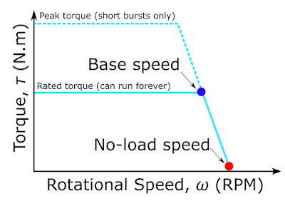
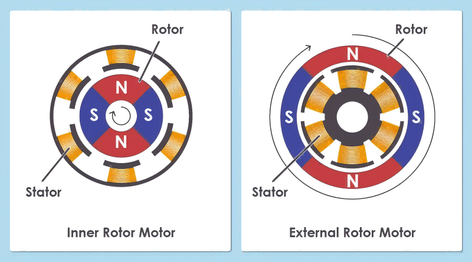
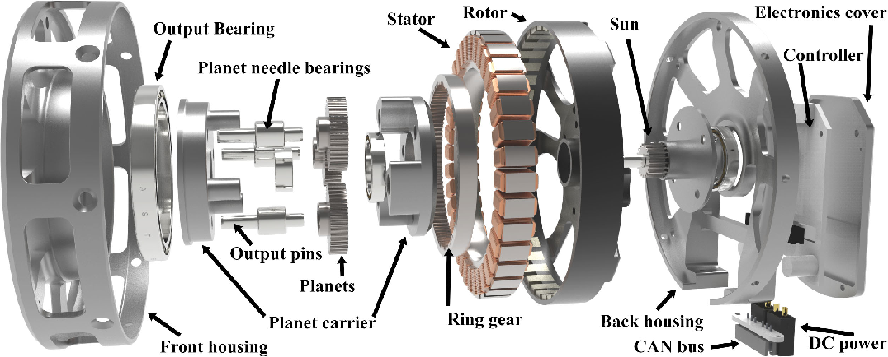

import FocDemo from "../../../../src/components/demos/FocDemo";

## Introduction: The Motor Inside the Simulator

Consider a locomotion policy that jumps lower on the real robot than in simulation, or whose landings change as the robot warms up. Motor voltage and thermal limits are possible causes to check alongside the policy and the rest of the system.

A common simplified simulation model treats a robot joint as an ideal torque source. The commanded torque is assumed to reach the joint exactly, with no delay, no error, and no dependence on speed or temperature, with at most a single maximum torque limit attached. Real motors do not behave this way.

In a multi-joint robot, an actuator means, narrowly, the combination of a motor and a reducer, and broadly, a joint drive module that also integrates the encoder, motor driver, temperature sensor, and brake. A command from the policy becomes force only after passing through this module. The discrepancies that arise along the way differ slightly in nature. Some are **unmodeled dynamics** that the simulator does not model at all. Others are **modeling errors**, present in the model but with the wrong values, which have to be corrected through **system identification**. There is also data noise mixed into sensor readings and estimates; torque estimated from current in particular is one of the most common sources of noise in robot data. All three create the Sim-to-Real Gap, where a policy trained in simulation behaves differently on the real robot.

Legged robot research shows how much these discrepancies matter. In the ANYmal work, an **actuator network** trained on input-output data from the real actuators was placed in the simulator, and the policy trained in simulation was transferred to the real robot [1](#ref-1).

So rather than listing design knowledge about BLDC motors, this post focuses on one question: which physical properties of the motor make the "commanded torque" differ from the "torque actually applied at the joint"? Discrepancies from the reducer are covered in the next post; here we look only at those that come from the motor itself.

## The Basic Motor Model: Current and Torque

Inside a motor, the magnetic field produced by current in the coils and the field of the permanent magnets exert forces on each other as they try to align, and those forces acting about the shaft become torque. The magnitude and direction of the torque are set by the magnitude and direction of the current, so controlling current means controlling torque.

The BLDC motors widely used in high-performance multi-joint robots put the coils on the **stator** and the permanent magnets on the **rotor**, and instead of brushes and a commutator, an inverter distributes current to each phase electronically to create a rotating magnetic field. By structure and operating principle, they strictly belong to the PMSM (permanent magnet synchronous motor) family [2](#ref-2), [3](#ref-3), but this post follows market convention and calls them BLDC.

In robot joints that need precise torque control, these motors are mostly driven with FOC (Field-Oriented Control). FOC uses the rotor's electrical angle as a reference to split the three-phase currents into a flux component $i_d$ and a torque component $i_q$ and controls each separately. For a surface-mounted permanent magnet motor operated at $i_d \approx 0$, where magnetic saturation can be neglected, torque is controlled through $i_q$, and the motor torque reduces to this very simple expression.

$$
\tau \approx K_t\, i_q
$$

For reluctance torque in interior permanent magnet motors, or for high-speed field weakening, the role of $i_d$ also has to be considered [2](#ref-2), [3](#ref-3).

FOC equations: Park transform, voltage equation, mechanical equation

The FOC controller uses the electrical angle $\theta$ read from the encoder to move the phase currents $(i_\alpha, i_\beta)$ from the stationary frame into a frame that rotates with the rotor (Park transform).

$$
\begin{bmatrix} i_d \\ i_q \end{bmatrix}
=
\begin{bmatrix} \cos\theta & \sin\theta \\ -\sin\theta & \cos\theta \end{bmatrix}
\begin{bmatrix} i_\alpha \\ i_\beta \end{bmatrix}
$$

The controller sets the voltage so that $i_q$ follows the command $i_q^*$. In other words, the FOC command is a current, but what the controller actually applies to the motor is a voltage, which passes through the inverse Park transform and PWM to become the inverter's switching. The current is the result of that voltage acting across the winding's resistance and inductance and against the back-EMF. That voltage, however, must satisfy the q-axis voltage equation, and its magnitude cannot exceed the DC bus voltage.

$$
v_q = R\,i_q + L\frac{di_q}{dt} + \omega_e L\, i_d + \omega_e \lambda,
\qquad \lVert v_{dq} \rVert \le V_{\mathrm{bus}}
$$

The last term, $\omega_e \lambda$, is the back-EMF. The torque the motor produces accelerates the rotor, so speed and current are tied together through the mechanical equation.

$$
J\dot\omega = K_t\, i_q - B\omega - \tau_{\mathrm{load}}
$$

The demo below simulates the three FOC equations above as written. Apply $i_q^*$ with no load and the rotor accelerates; near the no-load speed, where the back-EMF uses up almost all of the bus voltage, the measured $i_q$ falls well below the command. The commanded current fails to flow not because of the controller but because there is no voltage headroom left.

<FocDemo client:visible lang="en" />

$\tau \approx K_t\, i_q$ is how real hardware implements the simulator's "ideal torque source." The rest of this post is about where this equation breaks down. There are three main cases.

1. When there is not enough voltage to produce the desired $i_q$

2. When the torque the motor produces is spent on inertia and friction before it reaches the joint

3. When $K_t$ differs from its nominal value or changes over time

## Voltage and Back-EMF: A Torque Limit That Changes with Speed

Current determines torque, but producing that current takes voltage. Simplifying the q-axis voltage equation from the FOC equations above to a single phase gives the following [4](#ref-4).

$$
v = Ri + L\frac{di}{dt} + K_e\,\omega
$$

The last term, $K_e\omega$, is the **back-EMF**, the same term as $\omega_e\lambda$ in the q-axis equation written in terms of mechanical speed. The faster the motor spins, the larger the back-EMF, and the less voltage headroom is left for pushing current. The speed at which the back-EMF and the resistive voltage drop use up the voltage allowed by the DC bus and the inverter's modulation scheme is the **base speed**. Above it, the available torque drops quickly and reaches zero at the no-load speed.

<figure>
  
  <figcaption>Motor torque–speed limits. Up to the base speed the motor can deliver its rated torque; above it, back-EMF reduces the torque until it reaches zero at the no-load speed. Peak torque is allowed only for short periods. <a href="#ref-5">[5]</a></figcaption>
</figure>

### The Error of a Constant Torque Limit

When a joint is simplified to an ideal torque source in simulation, it is sometimes given just one constant torque limit independent of speed. A real motor's torque limit, however, is a function of speed. So motions that demand large torque at high speed, such as jumps or fast swings, work well in simulation but run short of torque on the real robot. The policy has effectively learned to exploit torque the simulator handed out for free.

There is one more factor: the DC bus voltage itself is not fixed. On a battery-powered robot, the voltage varies with state of charge and instantaneous load, so the torque-speed limit keeps shifting during an experiment. The same policy can behave differently on a full battery and on one that is nearly drained. You can check this limit by coupling the motor to a load motor and measuring the maximum torque at each speed, or by accelerating with no load and recording the speed at which the measured current starts to fall behind the command. Repeating the same measurement at different bus voltages also shows the difference due to battery charge.

### Response Delay

The passive electrical response of the winding can be estimated from the time constant $L/R$. The closed-loop response that tracks a command, however, also depends on the current controller gains, the sampling and PWM periods, and the available voltage; at high speed, back-EMF reduces the voltage headroom, so the current loop's response slows down too. In practice, larger delays usually come from communication and the higher-level control rate, which I will cover later in the series.

### Damping That Depends on Driver State

Back-EMF also appears when an external force turns the motor. If the driver is off and the phases are open, almost no current flows and the joint turns relatively freely; but if the phases are shorted or the circuit is closed through the driver, a resisting torque proportional to speed appears. With the phases shorted, the damping coefficient at low speed is roughly $K_t K_e/R$, and as speed rises and $\omega_e L$ approaches $R$, the inductance makes the braking torque fall again.

In other words, the same joint has different damping depending on the driver's state. With a single constant damping term in the model, the differences among a zero-torque command, a disabled driver, and brake mode do not show up in the model. When the joint is turned by external force, as in **kinesthetic teaching** where a person moves the robot by hand to demonstrate, these differences end up directly in the data. Backdriving the joint at a constant speed in each driver state and measuring the required torque lets you compare the damping of each state directly.

## Motor Geometry and Reflected Inertia: Mass the Simulator Easily Misses

### Torque Scales with the Square of the Radius

If the force per unit area that the air-gap surface between magnets and coils can produce, the air-gap shear stress σ, is taken as constant, then force is proportional to the air-gap area, and multiplying by the radius once more gives torque.

$$
\tau \approx \sigma \cdot (2\pi r L) \cdot r = 2\pi\sigma\, r^2 L
$$

Here r is the air-gap radius and L is the stack length. Doubling the radius quadruples the torque. This relationship drives the choice of motor geometry, and that choice in turn determines how heavy the joint feels.

<figure>
  
  <figcaption>Inner runner, with the rotor inside the stator, and outer runner, with the rotor outside <a href="#ref-6">[6]</a></figcaption>
</figure>

The comparison below describes design trends at similar electromagnetic loading and stack length. Actual performance has to be compared together with winding and cooling conditions.

- Inner runner: the rotor sits inside, so rotor inertia is small and high-speed operation is easy, but the small air-gap radius limits torque. So a high-speed motor is paired with a high reduction ratio. This is the typical configuration for industrial robot arms and collaborative robots.

- Outer runner: the rotor sits outside, so the air-gap radius and the torque are large. The rotor inertia is large too. So a high-torque motor is paired with a low reduction ratio, or used without a reducer as a direct drive. This is the typical configuration for QDD actuators in legged robots.

<figure>
  
  <figcaption>Exploded view of the MIT Mini Cheetah actuator. A planetary gear is placed inside a large-diameter outer-runner pancake motor to shorten the axial length. <a href="#ref-7">[7]</a></figcaption>
</figure>

### Reflected Inertia: Hidden Mass That Grows with the Square of the Ratio

Through a reducer, the motor rotor's inertia appears at the joint multiplied by the square of the reduction ratio N.

$$
J_{\mathrm{reflected}} = N^2 J_{\mathrm{rotor}}
$$

As an illustrative calculation, attach a 100:1 reducer to a small inner-runner motor with a rotor inertia of 1×10⁻⁵ kg·m², and the reflected inertia seen at the joint becomes 0.1 kg·m². That is about the same as the inertia of a 1 kg point mass 0.3 m from the joint (about 0.09 kg·m²). In a high-ratio joint, the rotor's contribution to inertia can exceed that of the link itself. The effect of the reduction ratio is covered in detail in the [next post](/hardware03/).

The problem is that robot models such as URDF often contain only link masses and inertias and leave out the rotor inertia. MuJoCo provides a per-joint parameter called armature for this [8](#ref-8), and most other simulators offer a similar setting. If this value is missing, the simulated joint moves much more lightly than the real one, and acceleration, collision response, and compliance to external forces all change. In QDD joints with outer-runner motors and low reduction ratios, $N^2 J_{\mathrm{rotor}}$ can be designed to be small. The error from omitting rotor inertia then shrinks as well, but the actual value still has to be computed from both the rotor inertia and the reduction ratio.

### Cogging and Friction

A motor produces some torque even at zero current: **cogging torque**, which varies periodically with rotor position because of the attraction between the permanent magnets and the iron core, and friction from the bearings and seals. Friction is a mix of Coulomb and viscous friction, and it also changes with temperature.

Simulators approximate friction with a single constant or omit it altogether, and they rarely model cogging. As a result, in slow motions and fine manipulation the real robot shows **stick-slip**, catching and releasing, along with periodic disturbances that depend on position. From a data perspective, the key point is that this is not random noise but structured noise tied to position. Cogging and torque ripple are covered in detail in the [post on torque ripple](/hardware05/).

## Errors in Current-Based Torque Estimation

Many robots estimate joint torque from motor current without a joint torque sensor. Including the reduction ratio N and the reducer efficiency η gives the following.

$$
\tau_{\mathrm{joint}} \approx \eta\, N\, K_t\, i_q
$$

The formula is simple, but each term hides a different kind of error.

| Error source | How it shows up | How to handle it |
| --- | --- | --- |
| Unit-to-unit variation in $K_t$ | Manufacturing tolerances and magnet variation make $K_t$ differ from the nominal value even for motors of the same model | Identify $K_t$ per joint with a load cell |
| Magnetic saturation | Near peak current $K_t$ drops, so the current-torque relationship becomes nonlinear in the high-torque range | Measure a current–torque map up to the high-current range |
| Cogging and torque ripple | Torque fluctuates periodically with rotor position | Position-dependent compensation table |
| Current sensor | Measurement noise, offset, and PWM switching ripple feed straight into the torque estimate | Offset calibration, sampling synchronized to PWM |
| Temperature | $K_t$ changes as the windings and magnets heat up (next section) | Log temperature, correct $K_t$ for temperature |
| Reducer efficiency and friction | $\eta$ varies with direction, speed, and load | Identify friction by direction and speed ([next post](/hardware03/)) |

These errors go straight into the data when current-based torque is used as a policy input or when collecting data that includes force information. On top of that, their size and sign differ from robot to robot, and even from joint to joint on the same robot. This is why the Embodiment Gap discussed in Part 1 can appear even between robots of the same model.

So for force-critical tasks, rather than trusting the nominal $K_t$ as is, you need to measure the actual torque with a load cell or F/T sensor and calibrate $K_t$ and friction per joint. When current-based torque estimates can be trusted is covered in detail in the [post on torque estimation and heat](/hardware06/).

## Heat: A Model That Changes Over Time

Heat changes model parameters during an experiment. In the illustrative thermal model in [06](/hardware06/), warming the windings and magnets from 25 °C to 75 °C raises copper resistance by about 19.5% and lowers $K_t$ by about 5%. The same current then produces about 5% less torque. These percentages follow the temperature coefficients used in that example; they are not ratings for every motor. If the driver also starts **derating**, its available current and torque limits fall. Thermal models and compensation methods are covered in detail in the [post on torque estimation and heat](/hardware06/).

## Reading a Datasheet as Simulation Parameters

A motor datasheet is usually used to pick a motor, but from a Physical AI perspective it is also a list of parameters for the simulator and the model. Reorganizing the topics above by datasheet entry gives the following.

| Datasheet value | Where it is used in the model or simulator | What happens if it is missing |
| --- | --- | --- |
| Rotor inertia | Joint armature (N²J) | The simulated joint moves more lightly than the real one |
| $K_e$ or $K_v$, phase resistance $R$, rated voltage | Speed-dependent torque limit | Torque at high speed is overestimated |
| Peak and continuous torque and current | Torque limit and allowable duty | A policy that uses torque the real motor cannot sustain |
| Torque constant $K_t$ | Current-to-torque conversion | Bias in torque estimates and commands |
| Phase inductance $L$ | Electrical time constant $L/R$, current loop model | Response differences due to voltage headroom and the controller |
| Thermal resistance, thermal time constant, maximum winding temperature | Thermal model, derating conditions | Torque loss in long experiments is not predicted |
| Cogging torque (if listed) | Position-dependent disturbance | Mismatch in slow and fine motions |

Even when only $K_v$ (rpm/V) is listed, as with RC motors, $K_t$ can be roughly estimated. The torque constant and the back-EMF constant are a pair that come from the same flux, so when the voltage and current conventions are chosen to conserve power, they have the same value in SI units.

$$
K_t \approx \frac{60}{2\pi K_v} \approx \frac{9.55}{K_v} \quad [\mathrm{N\,m/A}]
$$

In practice, though, datasheets and drivers quote voltage and current as phase or line-to-line values, and as RMS or peak, so this coefficient changes [9](#ref-9). For example, ODrive recommends setting the torque constant to $8.27/K_v$ [10](#ref-10), where 8.27 is 9.55 multiplied by $(3/2)/\sqrt 3 \approx 0.866$. This is the coefficient you get when $K_v$ is measured against line-to-line voltage and current is taken as the peak phase current of the amplitude-invariant d–q transform. The coefficients for each convention are covered in detail in [06](/hardware06/#definition-and-units-of-the-torque-constant). Above all, datasheet values are nominal. Once unit-to-unit variation and temperature dependence are taken into account, a datasheet is only the starting point for system identification, not the final set of parameters.

## Summary: Between the Ideal Torque Source and the Real Motor

The differences between a simulated joint and a real BLDC motor are summarized below.

| Factor | Common simulator assumption | Real motor | Resulting problem | Details |
| --- | --- | --- | --- | --- |
| Torque limit | Constant, independent of speed | Decreases as speed rises, depending on back-EMF and battery voltage | Torque in fast motions is overestimated | This post |
| Joint inertia | Link inertia only | Rotor reflected inertia $N^2J_m$ is added | Acceleration and collision response are lighter than in reality | [03](/hardware03/) |
| Friction and cogging | None or constant | Varies with position, speed, and temperature | Stick-slip at low speed, position-dependent disturbances | [Torque ripple](/hardware05/) |
| Current–torque relationship | $\tau = K_t i$ holds exactly | Unit-to-unit variation, saturation, ripple, sensor noise | Bias in torque estimates and commands | [Torque estimation](/hardware06/) |
| Change over time | Always the same | $K_t$ and $R$ change with temperature, and derating kicks in | Torque loss and data bias in long experiments | [Heat](/hardware06/) |
| Joint damping | A single constant | Back-EMF damping depends on driver state | Damping mismatch in backdriving and demonstration data | This post |

Use the task's speed, load, and operating duration to decide which discrepancies in the table need measurement or a model. A motor does not have to match an ideal torque source under every condition; the model must represent the departures that matter for the task.

A motor alone, however, rarely produces enough torque for a joint. In the next post we look at the reducer, which sits between the motor and the joint and can lengthen or shorten this distance through reflected inertia, friction, and backlash.

[Next post: [Robot Hardware 03] - Actuators (2): Reducers](/hardware03/)

## References

[1] J. Hwangbo et al., “Learning agile and dynamic motor skills for legged robots,” *Science Robotics*, vol. 4, no. 26, 2019. [Paper](https://doi.org/10.1126/scirobotics.aau5872)

[2] Microchip Technology, “Motor control algorithms.” [Source](https://www.microchip.com/en-us/solutions/technologies/motor-control-and-drive/motor-control-algorithms) {/* TODO(ref): needs verification — could not check the page title directly (access denied) */}

[3] STMicroelectronics, “PMSM and BLDC motor control.” [Source](https://www.st.com/en/applications/industrial-motor-control/pmsm-bldc-motor-control.html) {/* TODO(ref): needs verification — could not check the page title directly */}

[4] Microchip Developer Help, “BLDC motor control: position.” [Source](https://developerhelp.microchip.com/xwiki/bin/view/applications/motors/control-algorithms/bldc/position/) {/* TODO(ref): needs verification — could not check the page title directly */}

[5] Things in Motion, “Understanding BLDC (PMSM) electric motors: Base speed, no load speed and torque vs speed,” 2019. [Source](https://things-in-motion.blogspot.com/2019/05/understanding-bldc-pmsm-electric-motors.html)

[6] Gian Transmission, “A Comprehensive Guide to Brushless DC Motor.” [Source](https://www.gian-transmission.com/a-comprehensive-guide-to-brushless-dc-motor/)

[7] B. G. Katz, “A Low Cost Modular Actuator for Dynamic Robots,” M.S. thesis, Massachusetts Institute of Technology, 2018. [Source](https://www.semanticscholar.org/paper/A-low-cost-modular-actuator-for-dynamic-robots-Katz/80732f8a46655aa4a1037a7fbdc154f4ceb33c50)

[8] MuJoCo Documentation, “XML Reference — joint/armature.” [Source](https://mujoco.readthedocs.io/en/stable/XMLreference.html#body-joint-armature)

[9] maxon, “EC frameless DT 65 M,” datasheet, 2025. [PDF](https://www.maxongroup.com/medias/sys_master/root/9414557433886/EC-frameless-DT-65-M-EN-05-2025.pdf) {/* TODO(ref): needs verification — product name read from the file name */}

[10] ODrive Robotics, “Controller — Torque Control,” ODrive Documentation. [Source](https://docs.odriverobotics.com/v/latest/manual/control.html)
