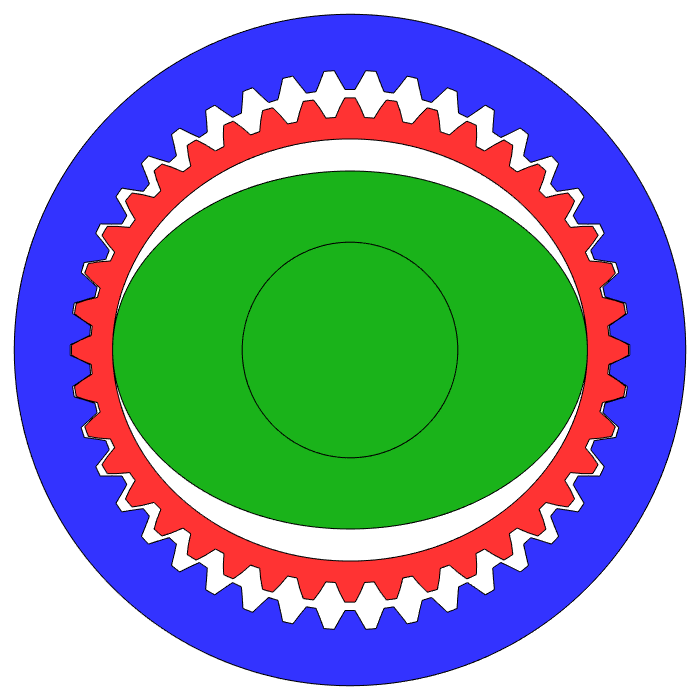

import HammerImpactDemo from "../../../../src/components/demos/HammerImpactDemo";

## Introduction: What Grows Along with Torque

Put a reducer on a desk and turn its output shaft by hand, and you feel right away what a gear ratio means. A bare motor shaft keeps spinning for a while after a light flick of the finger. Attach a 100:1 reducer to the same motor, and the output shaft barely moves even when you put your wrist into it, then stops the moment you let go. Shake it quickly back and forth and it feels like you are shaking something much heavier than the actual link. The rotor inertia and friction you could hardly feel at the motor shaft have grown, through the reducer, large enough to feel in your hand.

In the [previous post](/hardware02/) we looked at where a BLDC motor departs from an ideal torque source. But a motor small enough to mount directly at a joint usually cannot produce the torque needed to lift the link. So most multi-joint robots place a reducer between the motor and the joint. With a gear ratio of $N$, torque ideally goes up by a factor of $N$ and speed goes down to $1/N$. The weight and stiffness you felt in your hand are the price of that exchange.

In return for more torque, a reducer changes the dynamics of the joint.

1. The inertia of the motor rotor appears at the joint multiplied by $N^2$.
2. Friction and efficiency depend on the direction in which power flows.
3. The reducer is not a rigid body, so the motor and the link are connected through a finite torsional stiffness.

This post centers on the first of these, reflected inertia, and covers friction and stiffness along the way. Of the three, reflected inertia does the most to change how heavily a joint moves and how it responds to external forces. How these three make a robot feel in contact continues in the next post, on mechanical impedance. The structure and operating principle of each reducer, and the errors specific to each type, are covered in the subposts.

## The Ideal Reducer: Trading Speed for Torque

Let $\theta_m$ be the motor angle and $q$ the joint angle. For an ideal, rigidly connected reducer:

$$
\theta_m = N q, \qquad \dot\theta_m = N\dot q
$$

In forward driving, where power flows from the motor to the load, the joint torque is approximated with the forward efficiency $\eta_f$:

$$
\tau_{joint} \approx \eta_f\, N\, \tau_m
$$

Torque is not the only thing this relation buys. The resolution of the motor-side encoder becomes $N$ times finer in joint terms, and disturbance torque coming from the load looks $1/N$ as large on the motor side. This is why a high-ratio joint can support a heavy load and still hold its position accurately. The rest of this post looks at the costs that come in along with these benefits.

## Cost 1: Reflected Inertia

The rotor inertia $J_m$ appears in joint coordinates as $N^2 J_m$. You can see this directly by rewriting the rotor's kinetic energy in terms of joint velocity:

$$
T_m = \tfrac{1}{2} J_m \dot\theta_m^2 = \tfrac{1}{2}\left(N^2 J_m\right)\dot q^2
$$

Part 2 noted that this term is easy to leave out of a URDF and is entered in MuJoCo as armature. What matters here is that torque and inertia scale at different rates as the gear ratio changes. Torque scales with $N$, while reflected inertia scales with $N^2$.

### Optimal Gear Ratio for Acceleration

Consider a single joint with link inertia $J_L$, accelerated by motor torque $\tau_m$. Ignoring friction and gravity, the joint acceleration is

$$
\ddot q = \frac{N\,\tau_m}{J_L + N^2 J_m}
$$

When $N$ is small, the growing numerator dominates and acceleration increases. Once $N^2 J_m$ exceeds $J_L$, the denominator grows faster and acceleration falls. Differentiating and setting the result to zero gives the ratio that maximizes acceleration, $N^\ast = \sqrt{J_L/J_m}$: the point where reflected inertia equals link inertia. With the values from the Part 2 example, $J_m = 1\times10^{-5}\,\mathrm{kg\,m^2}$ and $J_L \approx 0.09\,\mathrm{kg\,m^2}$, this gives $N^\ast \approx 95$.

This calculation assumes fixed motor torque and ignores speed limits, friction, and external forces. Under those assumptions, raising the gear ratio increases static torque, but beyond the inertia-matching ratio it reduces acceleration.

### The Inertia Matrix of a Multi-Joint Robot

In a multi-joint robot, the same effect is added to the inertia matrix. Writing the joint-space dynamics as

$$
\left(M(q) + \mathbf{N}^{\top}\mathbf{J}_m\mathbf{N}\right)\ddot q + C(q,\dot q)\dot q + G(q) + \tau_f = \tau + \tau_{ext}
$$

$\mathbf{N}$ is the transmission matrix that maps joint angles to motor angles, and $\mathbf{J}_m$ is the diagonal matrix of rotor inertias. When each joint has its own reducer, $\mathbf{N}$ is diagonal and each diagonal entry gains $N_i^2 J_{m,i}$. In structures where one motor drives several joints, such as a cable differential, $\mathbf{N}$ is not diagonal, so reflected inertia also shows up in the off-diagonal entries that couple joints. This equation is a simplified model that leaves out the gyroscopic effects of the rotors.

The link inertia $M(q)$ changes with configuration, but the $N^2 J_m$ term does not. In high-ratio joints this constant term dominates the diagonal, so the inertia matrix becomes less sensitive to configuration and the coupling between joints looks relatively weak. This is one reason independent per-joint PID control works well on industrial robots.

### Response to External Forces and Impacts

The same inertia acts when the environment pushes on the robot. With only an external force acting, the joint acceleration is $\tau_{ext}/(J_L + N^2J_m)$, so a joint with large reflected inertia does not yield immediately to a fast external force. Adding reducer friction makes this inertia even larger, as shown below.

In an impact, this difference shows up as load. When the link hits something and stops suddenly, the rotor, which was spinning fast, must stop too, and the torque that decelerates it passes through the gear tooth flanks. Seen from the joint, this torque is $N^2J_m$ times the deceleration. So in the same collision, a high-ratio joint puts larger peak loads on its gear teeth, bearings, and housing. The actual load depends jointly on impact speed, the stiffness and backlash of the transmission, the compliance of the link, and the controller's torque limit.

The simulation below uses MuJoCo to compute what changes when only the gear ratio is varied, as a 1-DOF hammer swung at the same speed strikes a 5 kg stone resting on ice. At 160:1, the joint inertia $J_L + N^2J_m$, link inertia plus reflected inertia, is about 3.8 times that at 1:1. Swung at the same speed, the hammer sends the stone off about 2.6 times faster, and the stone slides about 6.8 times farther on the ice. From the environment's side, the joint feels like a correspondingly heavier object. Peak contact force rises by about 1.6 times, and about three quarters of the impact torque on the joint goes into stopping the rotor. All of that torque passes through the gear tooth flanks. These numbers treat the reducer as rigid; how the reducer's torsional stiffness changes them is covered [later](#how-the-link-separates-from-the-rotor-in-short-impacts).

<HammerImpactDemo client:visible lang="en" />

This difference shows up directly in tasks involving contact with people. Take an HRI task where a person high-fives the robot. However light the hand and link are made, if the gear ratio is high, what the person's hand hits is not the link mass but the effective mass including reflected inertia. In the 160:1 joint above, about three quarters of the effective mass at the hammer head comes from the rotor, so halving the link mass does not reduce the impulse the person receives by much.

## Cost 2: Reducer Friction

Reducer friction reaches the joint by two paths. One is the reducer's own loss at the gear tooth flanks and bearings; the other is motor-side friction amplified by the gear ratio. With 0.01 N·m of motor-side Coulomb friction and $N=100$, the joint sees 1 N·m of friction.

### Forward and Backward Efficiency

In backdriving, where power flows from the output shaft toward the motor, $\tau_{joint} \approx \eta_f N \tau_m$ cannot simply be inverted. The backward efficiency $\eta_b$ can differ from the forward efficiency $\eta_f$, and there is a separate backdrive starting torque needed to get the output shaft moving. Many high-ratio mechanisms measure lower $\eta_b$ than $\eta_f$, but this is not a universal law; it follows from tooth profile, preload, lubrication, and load. The Bilateral Drive Gear prototype evaluated in [1](#ref-1) reported a forward efficiency of 89.0%, a backward efficiency of 85.3%, and a backdrive starting torque of 0.020 N·m.

In the extreme case, torque at the output shaft alone cannot overcome internal friction and backdriving never starts. This is self-locking. Some worm gears are an example, but not all worm gears self-lock; it depends on the lead angle, the friction coefficient, and the lubrication condition.

### Reflected Inertia Depends on Power Flow Direction

Once reducer friction is included as an efficiency, the inertia the joint feels depends on the direction of power flow [2](#ref-2). In this efficiency-based model, the effective inertia coefficients for forward driving (FWD), where the motor drives the link, and backward driving (BWD), where an external force backdrives the joint, are:

$$
I_{\mathrm{FWD}} = \frac{J_L}{\eta_f} + N^2 J_m,
\qquad
I_{\mathrm{BWD}} = J_L + \frac{N^2 J_m}{\eta_b}
$$

In the forward direction, the motor has to make up for friction losses while accelerating the link, so the link inertia looks $1/\eta_f$ times larger. In the backward direction, the external force has to overcome friction and turn the rotor as well, so the reflected inertia looks $1/\eta_b$ times larger. The higher the gear ratio, the larger the share of reflected inertia, so a high-ratio joint with low backward efficiency responds to external forces much more heavily than it would without friction.

### Friction Varies with Speed, Load, and Temperature

Reducer efficiency is not a single number. Manufacturer catalogs usually give several efficiency curves, split by input speed, load torque, and lubricant temperature. In general, when load torque is below rated, friction takes a larger share and efficiency drops, and cold lubricant increases viscous loss.

This matters in two places. First, in kinesthetic teaching, where a person moves the robot by hand, or in tasks that must comply with external forces during contact, small external forces are blocked by the friction threshold and never turn into joint motion. Second, when estimating joint torque from motor current, which efficiency to multiply by changes with the direction of power flow. When current-based torque estimation holds is revisited in [the post on torque estimation and heat](/hardware06/).

## Cost 3: Torsional Stiffness of the Reducer

A reducer is not a rigid body. Gear teeth, the flexspline of a harmonic drive, bearings, and the housing all deform under load. Including this deformation turns the actuator from a single inertia into two inertias connected by a spring. With torsional stiffness $K_s$ and damping $B_s$ referred to the output shaft, the torque transmitted by the reducer is

$$
\tau_s = K_s\left(\frac{\theta_m}{N} - q\right) + B_s\left(\frac{\dot\theta_m}{N} - \dot q\right)
$$

In this model, $\theta_m$ and $q$ are no longer a single state. Once the motor-side inertia $N^2J_m$ and the link inertia $J_L$ are tied together by the spring $K_s$, an antiresonance and a resonance appear in the response from motor torque to motor velocity:

$$
\omega_{ar} = \sqrt{\frac{K_s}{J_L}}, \qquad
\omega_{r} = \sqrt{K_s\left(\frac{1}{J_L} + \frac{1}{N^2J_m}\right)}
$$

Raising position control gains close to the resonant frequency produces vibration and phase lag, so the position control bandwidth of a joint is often limited by this mechanical resonance rather than by the speed of the current loop.

### How the Link Separates from the Rotor in Short Impacts

With finite stiffness, reflected inertia is also not delivered in full at the moment of impact. If the collision is shorter than the antiresonance period, the link moves briefly separated from the rotor, and the first impact is taken mostly by the link inertia. For example, with $K_s = 1\times10^4\,\mathrm{N\,m/rad}$ and $J_L \approx 0.09\,\mathrm{kg\,m^2}$, the antiresonance is about 53 Hz with a period of about 19 ms, so in a hard collision lasting a few ms this separation is substantial. The hammer demo above treats the reducer as rigid, so this separation is missing. Running the same conditions with this torsional stiffness added to the reducer, at 160:1 the peak contact force of the first impact drops from 2340 N to about 1540 N, and the gear tooth torque drops from 519 N·m to 236 N·m. But the rotor's momentum has not gone away: the rotor pushes the link again through the spring, a second impact follows about 7 ms later, and the stone's final speed drops only slightly, from 1.36 m/s to 1.26 m/s. Stiffness reduces the peak load; the momentum the environment eventually receives does not drop much. Conversely, soft contact such as a human hand lasts longer, so reflected inertia shows through more fully. Deliberately placing a spring between the reducer and the link to use this separation as a design variable is the SEA (Series Elastic Actuator), covered in the next post.

### Twist the Motor Encoder Cannot See

Sensor placement creates one more problem. If the only encoder is on the motor shaft, the controller uses $\theta_m/N$ as the joint angle. When the reducer twists by $\tau/K_s$ under load, that twist does not appear in this value. For example, 20 N·m on a joint with $K_s = 1\times10^{4}\,\mathrm{N\,m/rad}$ gives a twist of 2 mrad (about 0.11°), which becomes about 1 mm of displacement at an end effector 0.5 m away. These numbers are assumptions for the calculation; real stiffness varies widely with reducer size, type, and torque range.

Joints in a simulator are usually modeled as rigid, so this twist and resonance do not exist there. This is the source of problems such as a position controller that ran well with high gains in simulation vibrating on the real robot, or end-effector positions computed from motor encoders drifting from the actual positions depending on load.

## Lost Motion and Transmission Error: Errors Tied to Position and Direction

A reducer also leaves its mark on the relation between input and output. There is backlash and lost motion, where tooth flanks separate and re-engage when torque reverses, and transmission error, which repeats periodically with input position even under constant load. Neither is random noise; both are errors tied to direction and position, so adding independent noise at every simulator step does not reproduce them. These errors are covered in detail, together with the cogging from Part 2, in [the post on repeating errors](/hardware05/), and the characteristics of each reducer type are summarized in the subposts.

## Joint Impedance Set by Hardware

The resistance you feel when pushing a joint from outside can be described as mechanical impedance. Treating the reducer as rigid and assuming the controller produces no torque, the hardware impedance seen at the output shaft is set by reflected inertia and friction:

$$
Z(s) = \frac{\tau_{ext}(s)}{\dot q(s)} \approx I_{\mathrm{BWD}}\,s + B
$$

$I_{\mathrm{BWD}}$ is the BWD reflected inertia from above, and $B$ is the viscous friction of the reducer and bearings. The torsional stiffness $K_s$ enters in series with these terms and, as shown above, separates the link from the rotor at high frequencies. For fast inputs such as impacts, these hardware terms show through directly; the hammer simulation above is such a case. How the joint feels once the stiffness and damping created by a position controller are added, and where the line falls between what control can change and what hardware decides, is covered in the next post.

## What the Gear Ratio Decides, and What the Reducer Type Decides

The costs so far can be split by what determines them.

- The gear ratio $N$ sets the size of reflected inertia and of the amplification of motor-side friction. With the same motor and the same ratio, $N^2J_m$ is the same regardless of reducer type. The inertia of the reducer's input stage $J_{in}$, such as a wave generator or an eccentric shaft, differs by type and is added along with it as $N^2(J_m + J_{in})$.
- The shape of the stiffness, lost motion, the period of transmission error, and the impact limit are set by the reducer's structure. Even at the same 100:1, a harmonic drive and a two-stage planetary gearbox leave different errors.

Comparing the three reducers most used in multi-joint robots by these criteria:

  <figure>
    
    <figcaption>
      <strong>Harmonic drive</strong>
      
Gets a large ratio from the elastic deformation of the flexspline, but leaves torque-dependent stiffness and a transmission error that repeats at twice the input rotation frequency

      <a href="/hardware03-01/">Read more →</a>
    </figcaption>
  </figure>
  <figure>
    
    <figcaption>
      <strong>Planetary gear</strong>
      
Shares load across several planet gears and backdrives easily at low ratios, but leaves clearance between tooth flanks and stiffness variation at the mesh period

      <a href="/hardware03-02/">Read more →</a>
    </figcaption>
  </figure>
  <figure>
    
    <figcaption>
      <strong>Cycloidal</strong>
      
Shares load across several lobes at once and withstands impacts well, but leaves clearance from the profile modification needed for assembly and vibration from the eccentric mass

      <a href="/hardware03-03/">Read more →</a>
    </figcaption>
  </figure>

| Reducer | Single-stage ratio | Stiffness characteristics | Main inherent errors |
| --- | --- | --- | --- |
| Harmonic drive | About 30:1–160:1 | Low in the low-torque range, increasing with torque | Hysteresis, transmission error repeating twice per input revolution |
| Planetary gear | About 3:1–10:1 | Varies periodically with mesh position | Backlash, stiffness variation at mesh frequency, uneven load sharing among planet gears |
| Cycloidal | Tens to one and above | Increases with load as more lobes come into contact | Clearance from the modified profile and output pins, vibration from eccentric mass |

## Measuring the Costs of a Reducer

All three costs can be measured directly at the joint. Inertia can be entered fairly accurately from datasheet values, and checked by applying torque steps to the joint with the link removed and taking the slope of the torque–acceleration line. Friction is identified per joint by running the joint at constant speed at several speeds and recording the average current, and backdrive starting torque is measured in both directions with a torque wrench on the output shaft. Stiffness comes from the slope of the curve obtained by locking the output shaft, ramping torque up and down, and recording $\theta_m/N - q$ with an output-side encoder; the resonant frequency is checked from the frequency response to a chirp current input. Stiffness and lost motion can only be represented in a simulator by splitting the joint into two degrees of freedom or adding a separate model, so they are usually handled indirectly through domain randomization or observation delay. How to put each of these into a simulator is collected in the [Actuator Part Summary](/hardware06/#actuator-part-summary).

## Gear Ratio as a Design Variable

A high gear ratio lets a small motor produce large static torque, and makes load disturbances look small on the motor side, which helps hold position precisely. The same choice, through reflected inertia and amplified friction, makes it hard for external forces to reach the motor. So a high-ratio joint is strong at holding position firmly but weak at reproducing small contact torques or yielding quickly to external forces.

Designs that ease this trade-off fall into two broad branches: QDD (Quasi-Direct Drive), which uses a high-torque motor and a low gear ratio to reduce reflected inertia and friction themselves, and SEA (Series Elastic Actuator), which places a deliberate spring between the reducer and the load. How the two make a robot feel different in contact, and what lowering the gear ratio costs in motor size and heat, are compared in the next post.

[Next post: [Robot Hardware 04] - Actuators (3): Mechanical Impedance](/hardware04/)

## References

[1] H. Matsuki, K. Nagano, and Y. Fujimoto, “Bilateral Drive Gear—A Highly Backdrivable Reduction Gearbox for Robotic Actuators,” *IEEE/ASME Transactions on Mechatronics*, vol. 24, no. 6, pp. 2661–2673, 2019. [Paper](https://doi.org/10.1109/TMECH.2019.2946403)

[2] Y. Sim and J. Ramos, “The dynamic effect of mechanical losses of transmissions on the equation of motion of legged robots,” arXiv:2106.01842, 2021. [arXiv](https://arxiv.org/abs/2106.01842)
