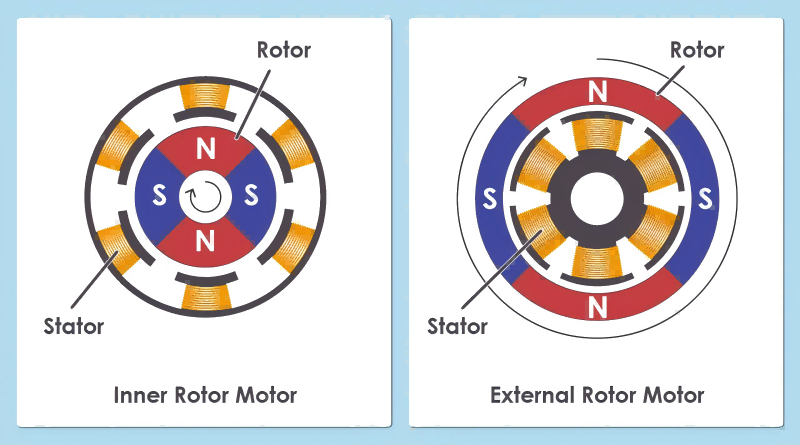
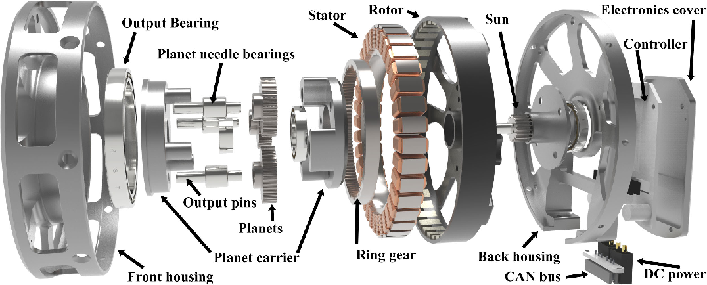
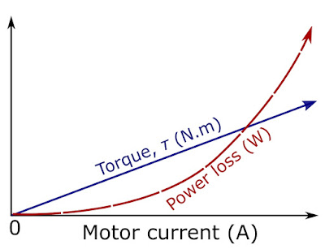
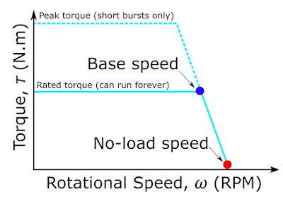

## 들어가며: 시뮬레이터 속의 모터

시뮬레이터에서 로봇 관절은 대개 이상적인 토크 소스로 다뤄집니다. 명령한 토크가 지연 없이, 오차 없이, 속도나 온도와 상관없이 그대로 관절에 걸린다고 가정하고, 기껏해야 최대 토크 한계 하나가 붙습니다. 실제 모터는 그렇지 않습니다.

다관절 로봇에서 액추에이터는 좁게는 모터와 감속기의 조합을, 넓게는 엔코더, 모터 드라이버, 온도 센서, 브레이크까지 통합한 관절 구동 모듈을 가리킵니다. 정책이 내린 명령은 이 모듈을 거쳐야 비로소 힘이 됩니다. 그리고 그 과정에서 생기는 차이는 세 가지 형태로 나타납니다.

- Sim-to-Real Gap: 시뮬레이터가 아예 모델링하지 않은 특성 때문에, 학습한 정책이 실제 로봇에서 다르게 동작합니다.

- 모델 오차(Modeling Error): 모델에는 들어 있지만 값이 틀린 경우입니다. 시스템 식별(System Identification)로 바로잡아야 하는 대상입니다.

- 데이터 노이즈: 센서 값이나 추정치에 섞이는 오차입니다. 특히 전류로 추정한 토크는 로봇 데이터에서 가장 흔한 노이즈원 중 하나입니다.

이 차이가 얼마나 중요한지는 보행 로봇 연구에서 잘 드러납니다. ANYmal 연구에서는 실제 액추에이터의 입출력 데이터로 학습한 액추에이터 네트워크(Actuator Network)를 시뮬레이터에 넣어 시뮬레이션에서 학습한 정책을 실제 로봇으로 옮겼습니다 [9](#ref-9).

그래서 이 글은 BLDC 모터의 설계 지식을 나열하기보다 한 가지 질문에 집중합니다. 모터의 어떤 물리적 특성이 '명령한 토크'와 '실제로 관절에 걸린 토크'를 다르게 만드는가? 감속기에서 생기는 차이는 다음 글에서 다루고, 여기서는 모터 자체에서 생기는 차이만 살펴보겠습니다.

## 모터의 기본 모델: 전류가 토크가 된다

모터 안에서는 코일에 흐르는 전류가 만든 자기장과 영구자석의 자기장이 서로 정렬하려는 방향으로 힘을 주고받고, 이 힘이 회전축을 중심으로 작용해 토크가 됩니다. 토크의 크기와 방향은 전류의 세기와 방향으로 결정되므로, 전류를 제어하면 토크를 제어할 수 있습니다.

<figure>
  
  <figcaption>BLDC 모터의 작동 원리 <a href="#ref-1">[1]</a></figcaption>
</figure>

고성능 다관절 로봇에서 널리 쓰이는 BLDC 모터는 스테이터(Stator)에 코일을, 로터(Rotor)에 영구자석을 두고, 브러시와 정류자 대신 인버터가 각 상의 전류를 전자적으로 분배해 회전 자기장을 만듭니다. 구조와 동작 원리로 보면 엄밀히는 PMSM(영구자석 동기모터) 계열이지만 [5](#ref-5), [6](#ref-6), 이 글에서는 시장 관례대로 BLDC라고 부르겠습니다.

정밀 토크 제어가 필요한 로봇 관절에서는 이 모터를 주로 FOC(Field-Oriented Control)로 구동합니다. FOC는 로터의 전기각을 기준으로 3상 전류를 자속 성분 i_d와 토크 성분 i_q로 나누어 제어하는 방식입니다. 자기 포화를 무시할 수 있는 표면부착형 영구자석 모터의 $i_d \approx 0$ 운전에서는 $i_q$로 토크를 제어하므로, 모터의 토크는 다음의 아주 단순한 식으로 정리됩니다.

$$
\tau \approx K_t\, i_q
$$

매입형 영구자석 모터의 릴럭턴스 토크나 고속 약계자 운전에서는 $i_d$의 역할도 함께 고려해야 합니다 [5](#ref-5), [6](#ref-6).

이 식이 시뮬레이터 속 '이상적인 토크 소스'를 실제 하드웨어에서 구현하는 방법입니다. 그리고 이 글의 나머지는 이 식이 어디서 깨지는가에 대한 이야기입니다. 크게 세 가지 경우가 있습니다.

1. 전압이 부족해 원하는 i_q를 만들 수 없을 때

2. 모터가 만든 토크가 관절에 닿기 전에 관성과 마찰에 쓰일 때

3. Kt가 공칭값과 다르거나 시간에 따라 변할 때

## 전압과 역기전력: 토크 한계는 상수가 아니다

전류는 토크를 결정하지만, 그 전류를 만들려면 전압이 필요합니다. 모터 한 상의 전기적 거동은 다음 식으로 단순화할 수 있습니다 [8](#ref-8).

$$
v = Ri + L\frac{di}{dt} + K_e\,\omega
$$

마지막 항 $K_e\omega$가 역기전력(Back-EMF)입니다. 모터가 빨리 돌수록 역기전력이 커지고, 그만큼 전류를 밀어 넣는 데 쓸 수 있는 전압 여유가 줄어듭니다. 역기전력과 저항 전압강하 등이 DC bus와 인버터 변조 방식이 허용하는 전압 여유를 소진하는 기저 속도(Base Speed)를 넘으면 낼 수 있는 토크가 빠르게 줄어듭니다.

### 상수 토크 한계로 단순화하면

시뮬레이션에서 관절을 이상적인 토크 소스로 단순화하면, 속도와 무관한 상수 토크 한계 하나만 두기도 합니다. 하지만 실제 모터의 토크 한계는 속도의 함수입니다. 그래서 점프나 빠른 스윙처럼 고속 구간에서 큰 토크를 요구하는 동작은 시뮬레이션에서는 잘 되다가 실제 로봇에서는 토크가 모자라게 됩니다. 정책이 시뮬레이터가 공짜로 준 토크를 활용하도록 학습된 셈입니다.

여기에 한 가지가 더 있습니다. DC bus 전압 자체가 고정값이 아니라는 점입니다. 배터리로 구동하는 로봇은 잔량과 순간 부하에 따라 전압이 변하고, 그에 따라 토크-속도 한계도 실험 중에 계속 움직입니다. 같은 정책이라도 배터리가 가득 찼을 때와 방전 직전에 다르게 동작할 수 있습니다.

### 응답 지연

권선의 수동적인 전기 응답은 시정수 $L/R$로 가늠할 수 있습니다. 다만 명령을 추종하는 폐루프 응답은 전류 제어기의 이득, 샘플링과 PWM 주기, 가용 전압에도 좌우됩니다. 다만 고속에서는 역기전력 때문에 전압 여유가 줄어 전류 루프의 응답도 함께 느려집니다. 실제로 더 큰 지연은 대개 통신과 상위 제어 주기에서 오는데, 이 부분은 시리즈 후반에서 다루겠습니다.

### 드라이버 상태에 따라 달라지는 댐핑

외력으로 모터가 돌 때도 역기전력이 생깁니다. 드라이버가 꺼져 상이 열려 있으면 전류가 거의 흐르지 않아 관절이 비교적 자유롭게 돌지만, 상이 단락되거나 드라이버를 통해 회로가 닫혀 있으면 속도에 비례하는 저항 토크가 생깁니다. 단락 시 댐핑 계수는 대략 $K_t K_e/R$입니다.

즉 같은 관절이라도 드라이버가 어떤 상태냐에 따라 관절의 댐핑이 달라집니다. 모델에 상수 댐핑 하나만 넣으면, 토크 0 명령, 드라이버 비활성, 브레이크 모드 사이의 차이는 모델에 드러나지 않습니다. 사람이 로봇을 손으로 움직여 시연하는 키네스테틱 티칭(Kinesthetic Teaching)처럼 관절을 외력으로 돌리는 상황에서는 이 차이가 데이터에 그대로 남습니다.

## 모터 형상과 반사 관성: 시뮬레이터가 놓치기 쉬운 질량

### 토크는 반경의 제곱에 비례한다

자석과 코일이 상호작용하는 공극 면에서 단위 면적당 낼 수 있는 힘, 즉 공극 전단응력 σ가 일정하다고 하면 힘은 공극 면적에 비례하고, 여기에 반경을 한 번 더 곱한 것이 토크입니다.

$$
\tau \approx \sigma \cdot (2\pi r L) \cdot r = 2\pi\sigma\, r^2 L
$$

여기서 r은 공극 반경, L은 적층 길이입니다. 반경을 2배로 키우면 토크는 4배가 됩니다. 이 관계가 모터 형상 선택을 좌우하고, 형상 선택은 다시 관절이 얼마나 무겁게 느껴지는지를 좌우합니다.

<figure>
  
  <figcaption>BLDC 모터의 종류 <a href="#ref-2">[2]</a></figcaption>
</figure>

아래 비교는 유사한 전자기 부하와 적층 길이에서 나타나는 설계 경향입니다. 실제 성능은 권선과 냉각 조건까지 함께 비교해야 합니다.

- Inner Runner(내전형): 로터가 안쪽에 있어 로터 관성이 작고 고속 회전에 유리하지만, 공극 반경이 작아 토크가 작습니다. 그래서 고속 모터 + 높은 감속비로 쓰입니다. 산업용 로봇 팔과 협동 로봇의 대표적인 구성입니다.

- Outer Runner(외전형): 로터가 바깥쪽에 있어 공극 반경이 크고 토크가 큽니다. 대신 로터 관성도 큽니다. 그래서 **고토크 모터 + 낮은 감속비(또는 직구동)**로 쓰입니다. 보행 로봇 QDD 액추에이터의 대표적인 구성입니다.

<figure>
  
  <figcaption>MIT Mini Cheetah에 사용된 외전형 팬케이크 모터 <a href="#ref-3">[3]</a></figcaption>
</figure>

### 반사 관성: 감속비의 제곱으로 커지는 숨은 질량

감속기를 통과하면 모터 로터의 관성은 감속비 N의 제곱만큼 커져서 관절에 나타납니다.

$$
J_{\mathrm{reflected}} = N^2 J_{\mathrm{rotor}}
$$

예를 들어 로터 관성이 1×10⁻⁵ kg·m²인 작은 내전형 모터에 100:1 감속기를 달면, 관절에서 보이는 반사 관성은 0.1 kg·m²가 됩니다. 1 kg짜리 링크가 관절에서 0.3 m 떨어져 있을 때의 관성(약 0.09 kg·m²)과 맞먹는 크기입니다. 높은 감속비 관절에서는 링크보다 로터의 관성 기여가 링크 자체의 관성보다 클 수 있다는 뜻입니다.

문제는 URDF 같은 로봇 모델에 링크의 질량과 관성만 들어 있고, 로터 관성은 빠져 있는 경우가 많다는 점입니다. MuJoCo는 이를 위해 관절마다 armature라는 파라미터를 두고 있고 [10](#ref-10), 다른 시뮬레이터들도 대개 비슷한 항목을 제공합니다. 이 값을 빠뜨리면 시뮬레이션 속 관절은 실제보다 훨씬 가볍게 움직이고, 가속도, 충돌 반응, 외력에 대한 순응성이 모두 달라집니다. 외전형 모터와 낮은 감속비를 쓰는 QDD 관절에서는 $N^2 J_{\mathrm{rotor}}$를 작게 설계할 수 있습니다. 이 경우 로터 관성을 생략해서 생기는 오차도 줄지만, 실제 값은 로터 관성과 감속비를 함께 계산해야 합니다.

### 코깅과 마찰

모터에는 전류가 0이어도 생기는 토크가 있습니다. 영구자석과 철심 사이의 인력 때문에 로터 위치에 따라 주기적으로 변하는 코깅 토크(Cogging Torque)와, 베어링과 실링에서 생기는 마찰입니다. 마찰은 쿨롱 마찰과 점성 마찰이 섞여 있고 온도에 따라서도 변합니다.

시뮬레이터는 마찰을 상수 하나로 근사하거나 아예 생략하고, 코깅은 거의 모델링하지 않습니다. 그 결과 저속 동작과 미세 조작에서 실제 로봇은 걸렸다 풀렸다 하는 스틱-슬립(Stick-Slip)을 보이고, 위치에 따라 주기적인 외란이 생깁니다. 데이터 관점에서는 무작위 노이즈가 아니라 위치에 묶인 구조화된 노이즈라는 점이 중요합니다. 토크 리플은 [로봇 하드웨어 05 - 액추에이터 (4): 토크 리플](/hardware05-kr/)에서 자세히 다룹니다.

## 전류는 토크가 아니다: 토크 추정의 오차

많은 로봇은 관절 토크 센서 없이 모터 전류로 관절 토크를 추정합니다. 감속비 N과 감속기 효율 η까지 넣으면 다음과 같습니다.

$$
\tau_{\mathrm{joint}} \approx \eta\, N\, K_t\, i_q
$$

간단한 식이지만, 각 항에 서로 다른 성격의 오차가 숨어 있습니다.

| 오차 원인 | 어떻게 나타나는가 | 분류 |
| --- | --- | --- |
| Kt의 개체 차이 | 제조 공차와 자석 편차로 같은 모델의 모터라도 Kt가 공칭값과 다릅니다 | 모델 오차 |
| 자기 포화 | 피크 전류 근처에서 Kt가 떨어져, 큰 토크 구간에서 전류와 토크의 관계가 비선형이 됩니다 | 모델 오차 |
| 코깅과 토크 리플 | 로터 위치에 따라 주기적으로 토크가 출렁입니다 | 구조화된 노이즈 |
| 전류 센서 | 측정 노이즈, 오프셋, PWM 스위칭 리플이 그대로 토크 추정에 섞입니다 | 데이터 노이즈 |
| 온도 | 권선과 자석이 데워지면 Kt가 변합니다 (다음 섹션) | 시간에 따라 변하는 오차 |
| 감속기 효율과 마찰 | 방향, 속도, 부하에 따라 η가 달라집니다 (다음 글) | 모델 오차 |

이 오차들은 전류 기반 토크를 정책의 입력으로 쓰거나 힘 정보가 들어간 데이터를 수집할 때 그대로 데이터에 들어갑니다. 게다가 로봇마다, 심지어 같은 로봇의 관절마다 오차의 크기와 방향이 다릅니다. 1편에서 다룬 Embodiment Gap이 같은 기종의 로봇 사이에서도 생길 수 있는 이유입니다.

그래서 힘이 중요한 작업이라면 공칭 Kt를 그대로 믿기보다, 로드셀이나 F/T 센서로 실제 토크를 측정해 Kt와 마찰을 관절별로 보정하는 과정이 필요합니다.

## 발열: 시간에 따라 변하는 모델

발열은 여러 모델 파라미터를 실험 도중에 함께 바꿉니다. 같은 로봇도 온도에 따라 다른 입력–출력 관계를 보일 수 있습니다.

<figure>
  
  <figcaption>전류에 의한 열 손실 <a href="#ref-4">[4]</a></figcaption>
</figure>

### 온도가 오르면 R과 Kt가 함께 변한다

구리의 저항은 상온 부근에서 1 °C당 약 0.4 %씩 커집니다. NdFeB 자석의 가역적 자속 온도계수를 1 °C당 약 −0.1 %로 가정하면 $K_t$도 그에 따라 떨어집니다. 실제 자석 계수는 등급과 온도 범위에 따라 달라집니다. 두 변화는 서로를 키웁니다. Kt가 떨어지면 같은 토크에 더 많은 전류가 필요하고, 늘어난 전류는 커진 저항에서 더 많은 열을 만듭니다.

예를 들어 권선과 자석의 온도가 25 °C에서 100 °C로 오르면, 저항은 약 30 % 커지고 Kt는 약 7~8 % 줄어듭니다. 같은 토크를 내는 데 드는 구리 손실은 약 1.5배가 됩니다.

같은 토크에서 발생하는 구리 손실을 비교할 때는 모터 상수(Motor Constant) $K_m$이 유용합니다. 실제 온도 상승 속도는 열용량과 냉각 경로에도 좌우됩니다.

$$
K_m = \frac{K_t}{\sqrt{R}}, \qquad \tau = K_m \sqrt{P_{\mathrm{copper}}}
$$

이 식에서 $K_m$의 단위는 $\mathrm{N\,m}/\sqrt{\mathrm W}$이며, 구리 손실의 제곱근당 토크를 나타냅니다. 같은 모터 형상과 구리 충전율을 유지하고 전류·저항의 정의를 일치시키면, 권선 수를 바꿔도 거의 변하지 않습니다. $K_m$이 높은 모터일수록 같은 작업에서 덜 데워지고, 그만큼 Kt 드리프트도 작습니다.

### 30분 뒤의 로봇은 다른 로봇이다

제어기는 공칭 Kt로 전류를 계산하므로, 위 예시라면 같은 전류 명령에서 실제 토크가 7~8 % 작아집니다. 이 변화는 서서히 일어나기 때문에 짧은 실험에서는 드러나지 않습니다. 하지만 장시간 데이터를 수집하거나 정책을 돌리면, 실험 초반의 로봇과 30분 뒤의 로봇이 서로 다른 로봇처럼 동작할 수 있습니다. 한 세션 안에서 수집한 데이터에도 온도에 따른 편향이 섞입니다.

더 급격한 변화도 있습니다. 온도 보호 기능을 사용하는 드라이버는 측정·추정한 권선 온도나 드라이버 온도가 한계에 가까워지면 전류를 제한하는 디레이팅(Derating)을 할 수 있습니다. 정책 입장에서는 실험 도중 토크 한계가 예고 없이 내려가는 셈인데, 열 모델과 보호 로직을 생략한 시뮬레이션에서는 이 변화가 나타나지 않습니다.

### 피크 토크와 연속 토크

데이터시트의 peak torque는 짧은 시간 동안만 허용되는 간헐 운전 성능입니다. 반복 동작을 하는 로봇이라면 작업 주기 전체의 RMS 토크가 연속 토크(Continuous Torque) 안에 들어오는지, 피크가 얼마나 오래 지속되는지를 함께 봐야 합니다. 시뮬레이션에서 피크 토크를 상수 한계로 두고 학습하면, 실제로는 몇 초밖에 유지할 수 없는 토크를 계속 쓰는 정책이 나올 수 있습니다.

<figure>
  
  <figcaption>모터의 속도와 토크 <a href="#ref-4">[4]</a></figcaption>
</figure>

실전에서는 관절 온도를 로깅하고, 필요하면 온도를 관측값에 넣거나 Kt를 온도에 따라 보정하며, 실험 사이에 냉각 시간을 두는 것만으로도 차이를 상당히 줄일 수 있습니다. 발열 모델링과 냉각 설계는 [로봇 하드웨어 07 - 액추에이터 (6): 발열](/hardware07-kr/)에서 자세히 다룹니다.

## 데이터시트를 시뮬레이션 파라미터로 읽기

모터 데이터시트는 보통 모터를 고르는 데 쓰지만, Physical AI 관점에서는 시뮬레이터와 모델에 넣을 파라미터 목록이기도 합니다. 앞에서 다룬 내용을 데이터시트 항목 기준으로 다시 정리하면 다음과 같습니다.

| 데이터시트 값 | 모델·시뮬레이터에서 쓰이는 곳 | 빠뜨리면 생기는 일 |
| --- | --- | --- |
| 로터 관성 | 관절 armature (N²J) | 시뮬레이션 속 관절이 실제보다 가볍게 움직임 |
| Ke 또는 Kv, 상 저항 R, 정격 전압 | 속도에 따른 토크 한계 | 고속 구간의 토크를 과대평가 |
| 피크·연속 토크와 전류 | 토크 한계와 허용 듀티 | 실제로는 유지할 수 없는 토크를 쓰는 정책 |
| 토크 상수 Kt | 전류–토크 환산 | 토크 추정과 명령에 편향 |
| 상 인덕턴스 L | 전기 시정수 $L/R$, 전류 루프 모델 | 전압 여유와 제어기에 따른 응답 차이 |
| 열저항, 열 시정수, 최대 권선 온도 | 열 모델, 디레이팅 조건 | 장시간 실험에서 토크 저하를 예측하지 못함 |
| 코깅 토크 (표기된 경우) | 위치에 따른 외란 | 저속·미세 동작의 불일치 |

RC 모터처럼 Kv(rpm/V)만 표기된 경우에는, SI 단위에서 Kt와 Ke가 이상적으로 같다는 관계를 이용해 Kt를 대략 추정할 수 있습니다.

$$
K_t \approx \frac{60}{2\pi K_v} \approx \frac{9.55}{K_v} \quad [\mathrm{N\,m/A}]
$$

다만 데이터시트마다 전압과 전류를 상 기준 또는 선간 기준으로, RMS 또는 peak로 표기하기 때문에 이 계수는 정의에 따라 달라집니다 [7](#ref-7). 무엇보다 데이터시트 값은 공칭값입니다. 개체 차이와 온도 의존성까지 생각하면, 데이터시트는 시스템 식별의 출발점일 뿐 최종 파라미터가 아닙니다.

## 정리: 이상적인 토크 소스와 실제 모터 사이

시뮬레이터 속 관절과 실제 BLDC 모터의 차이를 한눈에 정리하면 다음과 같습니다.

| 요소 | 시뮬레이터의 흔한 가정 | 실제 모터 | 주로 만드는 문제 |
| --- | --- | --- | --- |
| 토크 한계 | 속도와 무관한 상수 | 역기전력과 배터리 전압에 따라 속도가 오르면 감소 | Sim-to-Real Gap |
| 관절 관성 | 링크 관성만 | 로터의 반사 관성 N²J가 더해짐 | Sim-to-Real Gap, 모델 오차 |
| 마찰과 코깅 | 없음 또는 상수 | 위치·속도·온도에 따라 변함 | 모델 오차, 구조화된 노이즈 |
| 전류–토크 관계 | τ = Kt·i 가 정확히 성립 | 개체 차이, 포화, 리플, 센서 노이즈 | 모델 오차, 데이터 노이즈 |
| 시간에 따른 변화 | 항상 같음 | 온도에 따라 Kt와 R이 변하고 디레이팅 발생 | Sim-to-Real Gap, 데이터 편향 |
| 관절 댐핑 | 상수 하나 | 드라이버 상태에 따라 역기전력 댐핑이 달라짐 | 모델 오차 |

로봇에서 좋은 모터란 흔히 예측 가능하고, 빠르고, 일관되게 힘을 내는 모터라고 합니다. 이 표로 다시 말하면, 좋은 모터란 이상적인 토크 소스와의 거리가 짧은 모터, 즉 시뮬레이터가 가정한 모습에 가까운 모터입니다. 그리고 그 거리가 남아 있다면, 어디서 생기는지 알고 모델이나 데이터에서 다룰 수 있어야 합니다.

하지만 모터만으로는 관절에 필요한 토크를 충분히 내기 어렵습니다. 다음 글에서는 모터와 관절 사이에 놓여 반사 관성, 마찰, 백래시로 이 거리를 더 늘리거나 줄이는 감속기를 살펴보겠습니다.

[다음 포스트: [로봇 하드웨어 03] - 액추에이터 (2): 감속기](/hardware03-kr/)

## References

[1] [Source](https://docs.espressif.com/projects/esp-iot-solution/en/release-v2.0/motor/bldc/bldc_overview.html)

[2] [Source](https://www.gian-transmission.com/a-comprehensive-guide-to-brushless-dc-motor/)

[3] [Source](https://www.semanticscholar.org/paper/A-low-cost-modular-actuator-for-dynamic-robots-Katz/80732f8a46655aa4a1037a7fbdc154f4ceb33c50)

[4] [Source](https://things-in-motion.blogspot.com/2019/05/understanding-bldc-pmsm-electric-motors.html)

[5] [Source](https://www.microchip.com/en-us/solutions/technologies/motor-control-and-drive/motor-control-algorithms)

[6] [Source](https://www.st.com/en/applications/industrial-motor-control/pmsm-bldc-motor-control.html)

[7] [Source](https://www.maxongroup.com/medias/sys_master/root/9414557433886/EC-frameless-DT-65-M-EN-05-2025.pdf)

[8] [Source](https://developerhelp.microchip.com/xwiki/bin/view/applications/motors/control-algorithms/bldc/position/)

[9] J. Hwangbo et al., “Learning agile and dynamic motor skills for legged robots,” Science Robotics, vol. 4, no. 26, 2019. [Paper](https://doi.org/10.1126/scirobotics.aau5872).

[10] MuJoCo Documentation, [XML Reference — joint/armature](https://mujoco.readthedocs.io/en/stable/XMLreference.html#body-joint-armature).
