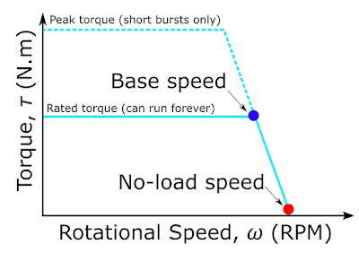
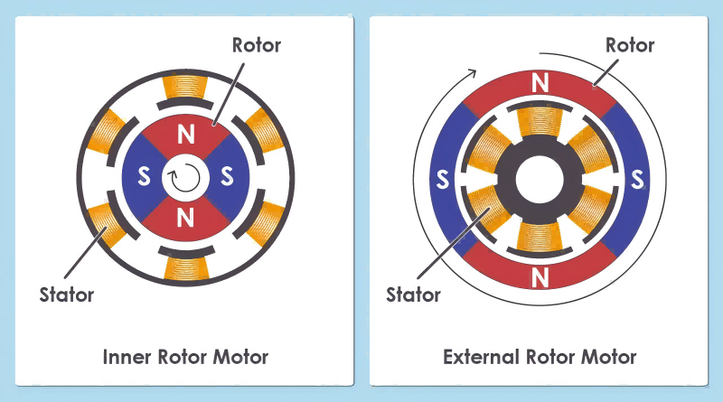
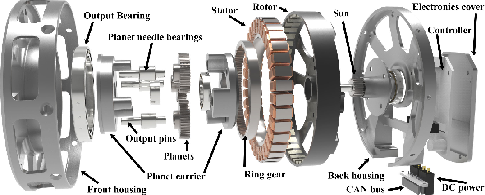

import FocDemo from "../../../../src/components/demos/FocDemo";

## 들어가며: 시뮬레이터 속의 모터

시뮬레이션에서 높이 뛰던 보행 정책이 실제 로봇에서는 낮게 뛰거나, 로봇이 데워지면서 착지가 달라지는 상황을 생각해 보겠습니다. 정책과 시스템의 다른 요소를 확인하면서 모터의 전압·열 한계도 원인 후보로 살펴봐야 합니다.

단순화한 시뮬레이션 모델에서는 로봇 관절을 이상적인 토크 소스로 다룹니다. 명령한 토크가 지연 없이, 오차 없이, 속도나 온도와 상관없이 그대로 관절에 걸린다고 가정하고, 기껏해야 최대 토크 한계 하나가 붙습니다. 실제 모터는 그렇지 않습니다.

다관절 로봇에서 액추에이터는 좁게는 모터와 감속기의 조합을, 넓게는 엔코더, 모터 드라이버, 온도 센서, 브레이크까지 통합한 관절 구동 모듈을 가리킵니다. 정책이 내린 명령은 이 모듈을 거쳐야 비로소 힘이 됩니다. 그 과정에서 생기는 차이는 성격이 조금씩 다릅니다. 어떤 것은 시뮬레이터가 아예 모델링하지 않은 특성(Unmodeled Dynamics)이고, 어떤 것은 모델에는 들어 있지만 값이 틀린 모델 오차(Modeling Error)라서 시스템 식별(System Identification)로 바로잡아야 합니다. 센서 값이나 추정치에 섞이는 데이터 노이즈도 있는데, 특히 전류로 추정한 토크는 로봇 데이터에서 가장 흔한 노이즈원 중 하나입니다. 셋 모두 시뮬레이션에서 학습한 정책이 실제 로봇에서 다르게 동작하는 Sim-to-Real Gap을 만듭니다.

이 차이가 얼마나 중요한지는 보행 로봇 연구에서 잘 드러납니다. ANYmal 연구에서는 실제 액추에이터의 입출력 데이터로 학습한 액추에이터 네트워크(Actuator Network)를 시뮬레이터에 넣어 시뮬레이션에서 학습한 정책을 실제 로봇으로 옮겼습니다 [1](#ref-1).

그래서 이 글은 BLDC 모터의 설계 지식을 나열하기보다 한 가지 질문에 집중합니다. 모터의 어떤 물리적 특성이 '명령한 토크'와 '실제로 관절에 걸린 토크'를 다르게 만드는가? 감속기에서 생기는 차이는 다음 글에서 다루고, 여기서는 모터 자체에서 생기는 차이만 살펴보겠습니다.

## 모터의 기본 모델: 전류와 토크의 관계

모터 안에서는 코일에 흐르는 전류가 만든 자기장과 영구자석의 자기장이 서로 정렬하려는 방향으로 힘을 주고받고, 이 힘이 회전축을 중심으로 작용해 토크가 됩니다. 토크의 크기와 방향은 전류의 세기와 방향으로 결정되므로, 전류를 제어하면 토크를 제어할 수 있습니다.

고성능 다관절 로봇에서 널리 쓰이는 BLDC 모터는 스테이터(Stator)에 코일을, 로터(Rotor)에 영구자석을 두고, 브러시와 정류자 대신 인버터가 각 상의 전류를 전자적으로 분배해 회전 자기장을 만듭니다. 구조와 동작 원리로 보면 엄밀히는 PMSM(영구자석 동기모터) 계열이지만 [2](#ref-2), [3](#ref-3), 이 글에서는 시장 관례대로 BLDC라고 부르겠습니다.

정밀 토크 제어가 필요한 로봇 관절에서는 이 모터를 주로 FOC(Field-Oriented Control)로 구동합니다. FOC는 로터의 전기각을 기준으로 3상 전류를 자속 성분 $i_d$와 토크 성분 $i_q$로 나누어 제어하는 방식입니다. 자기 포화를 무시할 수 있는 표면부착형 영구자석 모터의 $i_d \approx 0$ 운전에서는 $i_q$로 토크를 제어하므로, 모터의 토크는 다음의 아주 단순한 식으로 정리됩니다.

$$
\tau \approx K_t\, i_q
$$

매입형 영구자석 모터의 릴럭턴스 토크나 고속 약계자 운전에서는 $i_d$의 역할도 함께 고려해야 합니다 [2](#ref-2), [3](#ref-3).

FOC 제어 수식: Park 변환, 전압 방정식, 기계 방정식

FOC 제어기는 엔코더로 읽은 전기각 $\theta$를 이용해, 정지 좌표계의 상 전류 $(i_\alpha, i_\beta)$를 로터와 함께 도는 좌표계로 옮깁니다(Park 변환).

$$
\begin{bmatrix} i_d \\ i_q \end{bmatrix}
=
\begin{bmatrix} \cos\theta & \sin\theta \\ -\sin\theta & \cos\theta \end{bmatrix}
\begin{bmatrix} i_\alpha \\ i_\beta \end{bmatrix}
$$

제어기는 $i_q$가 명령 $i_q^*$를 따라가도록 전압을 정합니다. 즉 FOC의 명령은 전류이지만 제어기가 모터에 실제로 거는 것은 전압이고, 이 전압이 역 Park 변환과 PWM을 거쳐 인버터의 스위칭이 됩니다. 전류는 그 전압이 권선의 저항·인덕턴스와 역기전력에 걸려 생긴 결과입니다. 그런데 그 전압은 q축 전압 방정식을 만족해야 하고, 크기는 DC 버스 전압을 넘을 수 없습니다.

$$
v_q = R\,i_q + L\frac{di_q}{dt} + \omega_e L\, i_d + \omega_e \lambda,
\qquad \lVert v_{dq} \rVert \le V_{\mathrm{bus}}
$$

마지막 항 $\omega_e \lambda$가 역기전력입니다. 모터가 만든 토크는 로터를 가속하므로, 속도와 전류는 기계 방정식을 통해 서로 묶여 있습니다.

$$
J\dot\omega = K_t\, i_q - B\omega - \tau_{\mathrm{load}}
$$

아래 데모는 위 FOC 제어 수식의 세 식을 그대로 시뮬레이션합니다. 부하 없이 $i_q^*$를 주면 로터가 가속하다가, 역기전력이 버스 전압을 거의 다 쓰는 무부하 속도 근처에서 측정 $i_q$가 명령보다 크게 작아집니다. 명령한 전류가 흐르지 않는 이유가 제어기가 아니라 전압 여유에 있다는 뜻입니다.

<FocDemo client:visible lang="ko" />

$\tau \approx K_t\, i_q$가 시뮬레이터 속 '이상적인 토크 소스'를 실제 하드웨어에서 구현하는 방법입니다. 그리고 이 글의 나머지는 이 식이 어디서 깨지는가에 대한 이야기입니다. 크게 세 가지 경우가 있습니다.

1. 전압이 부족해 원하는 $i_q$를 만들 수 없을 때

2. 모터가 만든 토크가 관절에 닿기 전에 관성과 마찰에 쓰일 때

3. $K_t$가 공칭값과 다르거나 시간에 따라 변할 때

## 전압과 역기전력: 속도에 따라 변하는 토크 한계

전류는 토크를 결정하지만, 그 전류를 만들려면 전압이 필요합니다. 위 FOC 제어 수식의 q축 전압 방정식을 한 상으로 단순화하면 다음과 같습니다 [4](#ref-4).

$$
v = Ri + L\frac{di}{dt} + K_e\,\omega
$$

마지막 항 $K_e\omega$가 역기전력(Back-EMF)이고, q축 식의 $\omega_e\lambda$와 같은 항을 기계 속도 기준으로 쓴 것입니다. 모터가 빨리 돌수록 역기전력이 커지고, 그만큼 전류를 밀어 넣는 데 쓸 수 있는 전압 여유가 줄어듭니다. 역기전력과 저항 전압강하가 DC bus와 인버터 변조 방식이 허용하는 전압을 다 쓰는 속도가 기저 속도(Base Speed)이고, 이 속도를 넘으면 낼 수 있는 토크가 빠르게 줄어 무부하 속도에서 0이 됩니다.

<figure>
  
  <figcaption>모터의 토크–속도 한계. 기저 속도까지는 정격 토크를 낼 수 있고, 그 위에서는 역기전력 때문에 토크가 줄어 무부하 속도에서 0이 됩니다. 피크 토크는 짧은 시간만 허용됩니다. <a href="#ref-5">[5]</a></figcaption>
</figure>

### 상수 토크 한계로 단순화할 때의 오차

시뮬레이션에서 관절을 이상적인 토크 소스로 단순화하면, 속도와 무관한 상수 토크 한계 하나만 두기도 합니다. 하지만 실제 모터의 토크 한계는 속도의 함수입니다. 그래서 점프나 빠른 스윙처럼 고속 구간에서 큰 토크를 요구하는 동작은 시뮬레이션에서는 잘 되다가 실제 로봇에서는 토크가 모자라게 됩니다. 정책이 시뮬레이터가 공짜로 준 토크를 활용하도록 학습된 셈입니다.

여기에 한 가지가 더 있습니다. DC bus 전압 자체가 고정값이 아니라는 점입니다. 배터리로 구동하는 로봇은 잔량과 순간 부하에 따라 전압이 변하고, 그에 따라 토크-속도 한계도 실험 중에 계속 움직입니다. 같은 정책이라도 배터리가 가득 찼을 때와 방전 직전에 다르게 동작할 수 있습니다. 이 한계는 부하 모터에 물려 속도별 최대 토크를 재거나, 무부하로 가속하면서 측정 전류가 명령을 따라가지 못하기 시작하는 속도를 기록하면 확인할 수 있습니다. 버스 전압을 바꿔 같은 측정을 반복하면 배터리 잔량에 따른 차이도 함께 볼 수 있습니다.

### 응답 지연

권선의 수동적인 전기 응답은 시정수 $L/R$로 가늠할 수 있습니다. 다만 명령을 추종하는 폐루프 응답은 전류 제어기의 이득, 샘플링과 PWM 주기, 가용 전압에도 좌우되며, 고속에서는 역기전력 때문에 전압 여유가 줄어 전류 루프의 응답도 함께 느려집니다. 실제로 더 큰 지연은 대개 통신과 상위 제어 주기에서 오는데, 이 부분은 시리즈 후반에서 다루겠습니다.

### 드라이버 상태에 따라 달라지는 댐핑

외력으로 모터가 돌 때도 역기전력이 생깁니다. 드라이버가 꺼져 상이 열려 있으면 전류가 거의 흐르지 않아 관절이 비교적 자유롭게 돌지만, 상이 단락되거나 드라이버를 통해 회로가 닫혀 있으면 속도에 비례하는 저항 토크가 생깁니다. 상을 단락했을 때 댐핑 계수는 저속에서 대략 $K_t K_e/R$이고, 속도가 올라 $\omega_e L$이 $R$에 가까워지면 인덕턴스 때문에 제동 토크가 다시 줄어듭니다.

즉 같은 관절이라도 드라이버가 어떤 상태냐에 따라 관절의 댐핑이 달라집니다. 모델에 상수 댐핑 하나만 넣으면, 토크 0 명령, 드라이버 비활성, 브레이크 모드 사이의 차이는 모델에 드러나지 않습니다. 사람이 로봇을 손으로 움직여 시연하는 키네스테틱 티칭(Kinesthetic Teaching)처럼 관절을 외력으로 돌리는 상황에서는 이 차이가 데이터에 그대로 남습니다. 드라이버 상태별로 관절을 일정 속도로 역구동하며 필요한 토크를 재면 각 상태의 댐핑을 직접 비교할 수 있습니다.

## 모터 형상과 reflected inertia: 시뮬레이터가 놓치기 쉬운 질량

### 반경의 제곱에 비례하는 토크

자석과 코일이 상호작용하는 공극 면에서 단위 면적당 낼 수 있는 힘, 즉 공극 전단응력 σ가 일정하다고 하면 힘은 공극 면적에 비례하고, 여기에 반경을 한 번 더 곱한 것이 토크입니다.

$$
\tau \approx \sigma \cdot (2\pi r L) \cdot r = 2\pi\sigma\, r^2 L
$$

여기서 r은 공극 반경, L은 적층 길이입니다. 반경을 2배로 키우면 토크는 4배가 됩니다. 이 관계가 모터 형상 선택을 좌우하고, 형상 선택은 다시 관절이 얼마나 무겁게 느껴지는지를 좌우합니다.

<figure>
  
  <figcaption>로터가 스테이터 안쪽에 있는 내전형과 바깥쪽에 있는 외전형 <a href="#ref-6">[6]</a></figcaption>
</figure>

아래 비교는 유사한 전자기 부하와 적층 길이에서 나타나는 설계 경향입니다. 실제 성능은 권선과 냉각 조건까지 함께 비교해야 합니다.

- Inner Runner(내전형): 로터가 안쪽에 있어 로터 관성이 작고 고속 회전에 유리하지만, 공극 반경이 작아 토크가 작습니다. 그래서 고속 모터에 높은 감속비를 붙여 씁니다. 산업용 로봇 팔과 협동 로봇의 대표적인 구성입니다.

- Outer Runner(외전형): 로터가 바깥쪽에 있어 공극 반경이 크고 토크가 큽니다. 대신 로터 관성도 큽니다. 그래서 고토크 모터에 낮은 감속비를 붙이거나 감속기 없이 직구동으로 씁니다. 보행 로봇 QDD 액추에이터의 대표적인 구성입니다.

<figure>
  
  <figcaption>MIT Mini Cheetah 액추에이터의 분해도. 지름이 큰 외전형 팬케이크 모터 안쪽에 유성기어를 넣어 축 방향 길이를 줄였습니다. <a href="#ref-7">[7]</a></figcaption>
</figure>

### reflected inertia: 감속비의 제곱으로 커지는 숨은 질량

감속기를 통과하면 모터 로터의 관성은 감속비 N의 제곱만큼 커져서 관절에 나타납니다.

$$
J_{\mathrm{reflected}} = N^2 J_{\mathrm{rotor}}
$$

계산 예시로 로터 관성이 1×10⁻⁵ kg·m²인 작은 내전형 모터에 100:1 감속기를 달면, 관절에서 보이는 reflected inertia는 0.1 kg·m²가 됩니다. 1 kg의 점질량이 관절에서 0.3 m 떨어져 있을 때의 관성(약 0.09 kg·m²)과 맞먹는 크기입니다. 높은 감속비 관절에서는 로터의 관성 기여가 링크 자체의 관성보다 클 수 있다는 뜻입니다. 감속비에 따른 영향은 [다음 글](/hardware03-kr/)에서 자세히 다룹니다.

문제는 URDF 같은 로봇 모델에 링크의 질량과 관성만 들어 있고, 로터 관성은 빠져 있는 경우가 많다는 점입니다. MuJoCo는 이를 위해 관절마다 armature라는 파라미터를 두고 있고 [8](#ref-8), 다른 시뮬레이터들도 대개 비슷한 항목을 제공합니다. 이 값을 빠뜨리면 시뮬레이션 속 관절은 실제보다 훨씬 가볍게 움직이고, 가속도, 충돌 반응, 외력에 대한 순응성이 모두 달라집니다. 외전형 모터와 낮은 감속비를 쓰는 QDD 관절에서는 $N^2 J_{\mathrm{rotor}}$를 작게 설계할 수 있습니다. 이 경우 로터 관성을 생략해서 생기는 오차도 줄지만, 실제 값은 로터 관성과 감속비를 함께 계산해야 합니다.

### 코깅과 마찰

모터에는 전류가 0이어도 생기는 토크가 있습니다. 영구자석과 철심 사이의 인력 때문에 로터 위치에 따라 주기적으로 변하는 코깅 토크(Cogging Torque)와, 베어링과 실링에서 생기는 마찰입니다. 마찰은 쿨롱 마찰과 점성 마찰이 섞여 있고 온도에 따라서도 변합니다.

시뮬레이터는 마찰을 상수 하나로 근사하거나 아예 생략하고, 코깅은 거의 모델링하지 않습니다. 그 결과 저속 동작과 미세 조작에서 실제 로봇은 걸렸다 풀렸다 하는 스틱-슬립(Stick-Slip)을 보이고, 위치에 따라 주기적인 외란이 생깁니다. 데이터 관점에서는 무작위 노이즈가 아니라 위치에 묶인 구조화된 노이즈라는 점이 중요합니다. 코깅과 토크 리플은 [토크 리플을 다루는 글](/hardware05-kr/)에서 자세히 다룹니다.

## 전류 기반 토크 추정의 오차

많은 로봇은 관절 토크 센서 없이 모터 전류로 관절 토크를 추정합니다. 감속비 N과 감속기 효율 η까지 넣으면 다음과 같습니다.

$$
\tau_{\mathrm{joint}} \approx \eta\, N\, K_t\, i_q
$$

간단한 식이지만, 각 항에 서로 다른 성격의 오차가 숨어 있습니다.

| 오차 원인 | 어떻게 나타나는가 | 어떻게 다루나 |
| --- | --- | --- |
| $K_t$의 개체 차이 | 제조 공차와 자석 편차로 같은 모델의 모터라도 $K_t$가 공칭값과 다릅니다 | 로드셀로 관절별 $K_t$를 식별 |
| 자기 포화 | 피크 전류 근처에서 $K_t$가 떨어져 큰 토크 구간에서 전류와 토크의 관계가 비선형이 됩니다 | 큰 전류 구간까지 전류–토크 지도를 측정 |
| 코깅과 토크 리플 | 로터 위치에 따라 주기적으로 토크가 출렁입니다 | 위치에 따른 보상표 |
| 전류 센서 | 측정 노이즈, 오프셋, PWM 스위칭 리플이 그대로 토크 추정에 섞입니다 | 오프셋 보정, PWM과 동기된 샘플링 |
| 온도 | 권선과 자석이 데워지면 $K_t$가 변합니다 (다음 절) | 온도 기록, 온도에 따른 $K_t$ 보정 |
| 감속기 효율과 마찰 | 방향, 속도, 부하에 따라 $\eta$가 달라집니다 | 방향·속도별 마찰 식별 ([다음 글](/hardware03-kr/)) |

이 오차들은 전류 기반 토크를 정책의 입력으로 쓰거나 힘 정보가 들어간 데이터를 수집할 때 그대로 데이터에 들어갑니다. 게다가 로봇마다, 심지어 같은 로봇의 관절마다 오차의 크기와 방향이 다릅니다. 1편에서 다룬 Embodiment Gap이 같은 기종의 로봇 사이에서도 생길 수 있는 이유입니다.

그래서 힘이 중요한 작업이라면 공칭 $K_t$를 그대로 믿기보다, 로드셀이나 F/T 센서로 실제 토크를 측정해 $K_t$와 마찰을 관절별로 보정하는 과정이 필요합니다. 전류 기반 토크 추정이 언제 믿을 만한지는 [토크 추정과 발열을 다루는 글](/hardware06-kr/)에서 자세히 다룹니다.

## 발열: 시간에 따라 변하는 모델

발열은 실험 도중에 모델 파라미터를 바꿉니다. [06](/hardware06-kr/)의 열 모델 예시에서는 권선과 자석이 25 °C에서 75 °C로 오르면 구리 저항은 약 19.5 % 커지고 $K_t$는 약 5 % 줄어듭니다. 같은 전류에서 토크도 약 5 % 작아집니다. 이 비율은 예시의 온도 계수에 따른 값이며 모든 모터의 사양을 뜻하지 않습니다. 드라이버의 디레이팅(Derating)까지 시작되면 가용 전류와 토크 한계도 내려갑니다. 온도 모델과 보정 방법은 [토크 추정과 발열을 다루는 글](/hardware06-kr/)에서 자세히 다룹니다.

## 데이터시트를 시뮬레이션 파라미터로 읽기

모터 데이터시트는 보통 모터를 고르는 데 쓰지만, Physical AI 관점에서는 시뮬레이터와 모델에 넣을 파라미터 목록이기도 합니다. 앞에서 다룬 내용을 데이터시트 항목 기준으로 다시 정리하면 다음과 같습니다.

| 데이터시트 값 | 모델·시뮬레이터에서 쓰이는 곳 | 빠뜨리면 생기는 일 |
| --- | --- | --- |
| 로터 관성 | 관절 armature (N²J) | 시뮬레이션 속 관절이 실제보다 가볍게 움직임 |
| $K_e$ 또는 $K_v$, 상 저항 $R$, 정격 전압 | 속도에 따른 토크 한계 | 고속 구간의 토크를 과대평가 |
| 피크·연속 토크와 전류 | 토크 한계와 허용 듀티 | 실제로는 유지할 수 없는 토크를 쓰는 정책 |
| 토크 상수 $K_t$ | 전류–토크 환산 | 토크 추정과 명령에 편향 |
| 상 인덕턴스 $L$ | 전기 시정수 $L/R$, 전류 루프 모델 | 전압 여유와 제어기에 따른 응답 차이 |
| 열저항, 열 시정수, 최대 권선 온도 | 열 모델, 디레이팅 조건 | 장시간 실험에서 토크 저하를 예측하지 못함 |
| 코깅 토크 (표기된 경우) | 위치에 따른 외란 | 저속·미세 동작의 불일치 |

RC 모터처럼 $K_v$(rpm/V)만 표기된 경우에도 $K_t$를 대략 추정할 수 있습니다. 토크 상수와 역기전력 상수는 같은 자속에서 나오는 짝이라, 전압과 전류의 기준을 전력이 보존되도록 맞추면 SI 단위에서 같은 값이 되기 때문입니다.

$$
K_t \approx \frac{60}{2\pi K_v} \approx \frac{9.55}{K_v} \quad [\mathrm{N\,m/A}]
$$

다만 실제 데이터시트와 드라이버는 전압과 전류를 상 기준 또는 선간 기준으로, RMS 또는 peak로 표기하기 때문에 이 계수가 달라집니다 [9](#ref-9). 예를 들어 ODrive는 토크 상수를 $8.27/K_v$로 설정하라고 안내하는데 [10](#ref-10), 8.27은 9.55에 $(3/2)/\sqrt 3 \approx 0.866$을 곱한 값입니다. $K_v$를 선간 전압 기준으로 재고, 전류를 진폭 불변 d–q 변환의 peak 상전류로 쓸 때 붙는 계수입니다. 기준에 따른 계수는 [06](/hardware06-kr/#토크-상수의-정의와-단위)에서 자세히 다룹니다. 무엇보다 데이터시트 값은 공칭값입니다. 개체 차이와 온도 의존성까지 생각하면, 데이터시트는 시스템 식별의 출발점일 뿐 최종 파라미터가 아닙니다.

## 정리: 이상적인 토크 소스와 실제 모터 사이

시뮬레이터 속 관절과 실제 BLDC 모터의 차이를 한눈에 정리하면 다음과 같습니다.

| 요소 | 시뮬레이터의 흔한 가정 | 실제 모터 | 생기는 문제 | 자세히 |
| --- | --- | --- | --- | --- |
| 토크 한계 | 속도와 무관한 상수 | 역기전력과 배터리 전압에 따라 속도가 오르면 감소 | 고속 동작의 토크를 과대평가 | 이 글 |
| 관절 관성 | 링크 관성만 | 로터의 reflected inertia $N^2J_m$이 더해짐 | 가속과 충돌 반응이 실제보다 가벼움 | [03](/hardware03-kr/) |
| 마찰과 코깅 | 없음 또는 상수 | 위치·속도·온도에 따라 변함 | 저속 스틱-슬립, 위치에 묶인 외란 | [토크 리플](/hardware05-kr/) |
| 전류–토크 관계 | $\tau = K_t i$가 정확히 성립 | 개체 차이, 포화, 리플, 센서 노이즈 | 토크 추정과 명령의 편향 | [토크 추정](/hardware06-kr/) |
| 시간에 따른 변화 | 항상 같음 | 온도에 따라 $K_t$와 $R$이 변하고 디레이팅 발생 | 장시간 실험에서 토크 저하, 데이터 편향 | [발열](/hardware06-kr/) |
| 관절 댐핑 | 상수 하나 | 드라이버 상태에 따라 역기전력 댐핑이 달라짐 | 역구동과 시연 데이터의 댐핑 불일치 | 이 글 |

작업의 속도, 하중과 운전 시간을 기준으로 표의 어떤 차이를 측정하거나 모델에 넣을지 정해야 합니다. 모터가 모든 조건에서 이상적인 토크 소스와 같을 필요는 없지만, 작업에 영향을 주는 차이는 모델에서 표현해야 합니다.

하지만 모터만으로는 관절에 필요한 토크를 충분히 내기 어렵습니다. 다음 글에서는 모터와 관절 사이에 놓여 reflected inertia, 마찰, 백래시로 이 거리를 더 늘리거나 줄이는 감속기를 살펴보겠습니다.

[다음 포스트: [로봇 하드웨어 03] - 액추에이터 (2): 감속기](/hardware03-kr/)

## References

[1] J. Hwangbo et al., “Learning agile and dynamic motor skills for legged robots,” *Science Robotics*, vol. 4, no. 26, 2019. [Paper](https://doi.org/10.1126/scirobotics.aau5872)

[2] Microchip Technology, “Motor control algorithms.” [Source](https://www.microchip.com/en-us/solutions/technologies/motor-control-and-drive/motor-control-algorithms) {/* TODO(ref): 확인 필요 — 페이지 제목을 직접 확인하지 못함(접근 거부) */}

[3] STMicroelectronics, “PMSM and BLDC motor control.” [Source](https://www.st.com/en/applications/industrial-motor-control/pmsm-bldc-motor-control.html) {/* TODO(ref): 확인 필요 — 페이지 제목을 직접 확인하지 못함 */}

[4] Microchip Developer Help, “BLDC motor control: position.” [Source](https://developerhelp.microchip.com/xwiki/bin/view/applications/motors/control-algorithms/bldc/position/) {/* TODO(ref): 확인 필요 — 페이지 제목을 직접 확인하지 못함 */}

[5] Things in Motion, “Understanding BLDC (PMSM) electric motors: Base speed, no load speed and torque vs speed,” 2019. [Source](https://things-in-motion.blogspot.com/2019/05/understanding-bldc-pmsm-electric-motors.html)

[6] Gian Transmission, “A Comprehensive Guide to Brushless DC Motor.” [Source](https://www.gian-transmission.com/a-comprehensive-guide-to-brushless-dc-motor/)

[7] B. G. Katz, “A Low Cost Modular Actuator for Dynamic Robots,” M.S. thesis, Massachusetts Institute of Technology, 2018. [Source](https://www.semanticscholar.org/paper/A-low-cost-modular-actuator-for-dynamic-robots-Katz/80732f8a46655aa4a1037a7fbdc154f4ceb33c50)

[8] MuJoCo Documentation, “XML Reference — joint/armature.” [Source](https://mujoco.readthedocs.io/en/stable/XMLreference.html#body-joint-armature)

[9] maxon, “EC frameless DT 65 M,” datasheet, 2025. [PDF](https://www.maxongroup.com/medias/sys_master/root/9414557433886/EC-frameless-DT-65-M-EN-05-2025.pdf) {/* TODO(ref): 확인 필요 — 제품명은 파일명에서 읽음 */}

[10] ODrive Robotics, “Controller — Torque Control,” ODrive Documentation. [Source](https://docs.odriverobotics.com/v/latest/manual/control.html)
