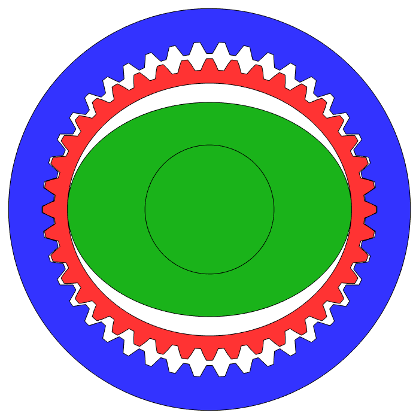

import HammerImpactDemo from "../../../../src/components/demos/HammerImpactDemo";

## 들어가며: 토크와 함께 커지는 것들

시뮬레이션에서는 손으로 살짝 밀면 밀리던 로봇 팔이, 실제 로봇에서는 꿈쩍도 하지 않다가 더 세게 밀면 갑자기 툭 움직입니다. 같은 팔을 빠르게 흔들면 시뮬레이션보다 굼뜨게 따라오고, 위치 제어 이득을 올리면 떨리기 시작합니다. 이 장면에는 모터와 관절 사이에 놓인 감속기의 비용이 모두 들어 있습니다.

[이전 글](/hardware02-kr/)에서 BLDC 모터가 이상적인 토크 소스와 어디서 다른지 살펴봤습니다. 그런데 관절에 바로 붙일 만한 크기의 모터는 대개 링크를 들어 올리는 데 필요한 토크를 내지 못합니다. 그래서 대부분의 다관절 로봇은 모터와 관절 사이에 감속기(Reducer)를 둡니다. 감속비가 $N$이면 이상적으로는 토크가 $N$배가 되고 속도는 $1/N$이 됩니다.

시뮬레이터에서 이 과정은 대개 보이지 않습니다. 정책은 관절 토크나 목표 위치를 출력하고, 시뮬레이터는 그 값이 관절에 그대로 걸린다고 가정합니다. 실제 감속기는 토크를 키우는 대가로 관절의 동역학을 바꿉니다.

1. 모터 로터의 관성이 $N^2$배로 커져 관절에 나타납니다.
2. 마찰과 효율이 힘이 흐르는 방향에 따라 달라집니다.
3. 감속기는 강체가 아니어서, 모터와 링크가 유한한 비틀림 강성으로 연결됩니다.

이 글은 첫 번째인 reflected inertia를 중심으로 마찰과 강성을 함께 살펴봅니다. 정책이 시뮬레이터에서 배운 관절의 무게와 외력에 대한 반응이 이 값에 따라 크게 달라지기 때문입니다. 이 세 가지가 접촉에서 로봇을 어떻게 느끼게 하는지는 다음 글인 기계적 임피던스에서 이어집니다. 감속기의 구조와 원리, 종류별로 남는 고유한 오차는 하위 글에서 다룹니다.

## 이상적인 감속기: 속도와 토크의 교환

모터 회전각을 $\theta_m$, 관절 각도를 $q$라고 하면 강체로 연결된 이상적인 감속기에서는 다음이 성립합니다.

$$
\theta_m = N q, \qquad \dot\theta_m = N\dot q
$$

동력이 모터에서 부하로 흐르는 정방향 구동(Forward Driving)에서 관절 토크는 정방향 효율 $\eta_f$를 넣어 다음과 같이 근사합니다.

$$
\tau_{joint} \approx \eta_f\, N\, \tau_m
$$

이 관계에서 얻는 것은 토크만이 아닙니다. 모터 측 엔코더의 분해능은 관절 기준으로 $N$배 촘촘해지고, 부하에서 들어오는 외란 토크는 모터 측에서 $1/N$로 작아 보입니다. 높은 감속비의 관절이 무거운 하중을 지지하면서 위치를 정확하게 유지하기 쉬운 이유입니다. 아래에서는 이 이점과 함께 들어오는 비용을 살펴봅니다.

## 대가 1: reflected inertia

모터 로터의 관성 $J_m$은 관절 좌표에서 $N^2 J_m$으로 나타납니다. 로터의 운동에너지를 관절 속도로 다시 쓰면 바로 확인할 수 있습니다.

$$
T_m = \tfrac{1}{2} J_m \dot\theta_m^2 = \tfrac{1}{2}\left(N^2 J_m\right)\dot q^2
$$

2편에서는 이 값이 URDF에서 빠지기 쉽고 MuJoCo에서는 armature로 넣는다는 점을 다뤘습니다. 여기서 볼 것은 감속비를 바꿀 때 토크와 관성이 서로 다른 속도로 변한다는 점입니다. 토크는 $N$에 비례하고 reflected inertia는 $N^2$에 비례합니다.

### 가속도 기준 최적 감속비

링크 관성이 $J_L$인 단일 관절을 모터 토크 $\tau_m$으로 가속한다고 하겠습니다. 마찰과 중력을 무시하면 관절 가속도는 다음과 같습니다.

$$
\ddot q = \frac{N\,\tau_m}{J_L + N^2 J_m}
$$

$N$이 작을 때는 분자가 커지는 효과가 커서 가속도가 늘어나지만, $N^2 J_m$이 $J_L$을 넘어서면 분모가 더 빨리 커져 가속도가 줄어듭니다. 미분해서 0으로 두면 가속도를 최대로 만드는 감속비는 $N^\ast = \sqrt{J_L/J_m}$, 즉 reflected inertia와 링크 관성이 같아지는 지점입니다. 2편의 예시처럼 $J_m = 1\times10^{-5}\,\mathrm{kg\,m^2}$, $J_L \approx 0.09\,\mathrm{kg\,m^2}$이면 $N^\ast \approx 95$입니다.

이 계산은 속도 한계, 마찰과 외력을 무시한 단순 모델입니다. 그래도 결론은 분명합니다. 감속비를 높이면 정적 토크는 계속 커지지만, 빠른 방향 전환에 쓸 수 있는 가속도는 어느 지점부터 오히려 줄어듭니다.

### 다관절 로봇의 관성 행렬

다관절 로봇에서는 같은 효과가 관성 행렬에 더해집니다. 관절 공간 동역학을 다음과 같이 쓰면

$$
\left(M(q) + \mathbf{N}^{\top}\mathbf{J}_m\mathbf{N}\right)\ddot q + C(q,\dot q)\dot q + G(q) + \tau_f = \tau + \tau_{ext}
$$

$\mathbf{N}$은 모터 각도와 관절 각도를 잇는 전달 행렬이고 $\mathbf{J}_m$은 로터 관성의 대각 행렬입니다. 관절마다 독립된 감속기를 쓰면 $\mathbf{N}$이 대각 행렬이어서 각 대각 성분에 $N_i^2 J_{m,i}$가 더해집니다. 케이블 차동 기구처럼 한 모터가 여러 관절을 움직이는 구조에서는 $\mathbf{N}$이 대각 행렬이 아니므로, reflected inertia가 관절 사이의 결합을 나타내는 비대각 성분에도 나타납니다. 이 식은 로터의 자이로 효과를 생략한 단순화 모델입니다.

링크 관성 $M(q)$는 자세에 따라 변하지만 $N^2 J_m$ 항은 자세와 무관합니다. 높은 감속비의 관절에서는 이 상수 항이 대각 성분을 지배하므로, 관성 행렬이 자세에 덜 민감해지고 관절 사이의 결합도 상대적으로 약해 보입니다. 산업용 로봇에서 관절별 독립 PID 제어가 잘 동작하는 이유 중 하나입니다.

### 외력과 충격에 대한 반응

같은 관성은 환경이 로봇을 밀 때도 작용합니다. 외력만 걸릴 때 관절 가속도는 $\tau_{ext}/(J_L + N^2J_m)$이므로, reflected inertia가 큰 관절은 빠른 외력에 즉시 물러나지 않습니다. 감속기 마찰까지 넣으면 이 관성은 뒤에서 보듯 더 커집니다.

충격에서는 이 차이가 하중으로 나타납니다. 링크가 무언가에 부딪혀 갑자기 멈추면 고속으로 돌던 로터도 멈춰야 하고, 로터를 감속시키는 토크는 감속기 치면을 통해 전달됩니다. 관절에서 보면 이 토크는 $N^2J_m$에 감속도를 곱한 크기입니다. 그래서 같은 충돌에서도 높은 감속비의 관절은 기어 치, 베어링과 하우징에 더 큰 순간 하중을 받습니다. 실제 하중은 충돌 속도, 전달계의 강성과 백래시, 링크의 순응성, 제어기의 토크 제한이 함께 정합니다.

아래 시뮬레이션은 같은 속도로 휘두른 1자유도 해머가 빙판 위에 정지한 5 kg 스톤을 칠 때, 감속비만 바꿨을 때의 차이를 MuJoCo로 계산한 것입니다. 160:1에서는 링크 관성과 reflected inertia를 합친 관절 관성 $J_L + N^2J_m$이 1:1의 약 3.8배가 되어, 같은 속도로 휘둘러도 스톤이 약 2.6배 빠르게 튕겨 나가고 빙판에서 약 6.8배 멀리 미끄러집니다. 환경 쪽에서 보면 관절이 그만큼 무거운 물체처럼 느껴진다는 뜻입니다. 최대 충돌력은 약 1.6배가 되고, 관절이 받는 충격 토크의 약 4분의 3이 로터를 멈추는 데 쓰입니다. 이 토크는 모두 감속기 치면을 지나갑니다. 이 수치는 감속기를 강체로 둔 결과이며, 감속기의 비틀림 강성이 이 결과를 어떻게 바꾸는지는 [뒤에서](#짧은-충돌에서-링크와-로터의-분리) 다룹니다.

<HammerImpactDemo client:visible lang="ko" />

이 차이는 사람과 접촉하는 작업에서 바로 드러납니다. 로봇과 하이파이브하는 HRI 작업을 생각해 보면, 손과 링크를 아무리 가볍게 만들어도 감속비가 높으면 사람 손이 부딪히는 것은 링크 질량이 아니라 reflected inertia까지 더한 유효 질량입니다. 위의 160:1 관절에서는 머리 기준 유효 질량의 약 4분의 3이 로터에서 오므로, 링크를 절반으로 가볍게 해도 사람이 받는 충격량은 크게 줄지 않습니다.

## 대가 2: 감속기 마찰

감속기의 마찰은 두 경로로 관절에 나타납니다. 하나는 기어 치면과 베어링에서 생기는 감속기 자체의 손실이고, 다른 하나는 모터 측 마찰이 감속비만큼 증폭된 것입니다. 모터 측 쿨롱 마찰이 0.01 N·m이고 $N=100$이면, 관절에서는 1 N·m의 마찰로 보입니다.

### 정방향 효율과 역방향 효율

동력이 출력축에서 모터 쪽으로 흐르는 역구동(Backdriving)에서는 $\tau_{joint} \approx \eta_f N \tau_m$을 뒤집어 쓸 수 없습니다. 역방향 효율 $\eta_b$는 정방향 효율 $\eta_f$와 다를 수 있고, 출력축을 돌리기 시작하는 데 필요한 역구동 개시 토크(Backdrive Starting Torque)가 따로 존재합니다. 많은 고감속 기구에서 $\eta_b$가 $\eta_f$보다 낮게 측정되지만, 이는 보편 법칙이 아니라 치형, 예압, 윤활과 하중에 따른 결과입니다. 약 1:102 Bilateral Drive Gear 시제품은 정방향 효율 89.0 %, 역방향 효율 85.3 %, 역구동 개시 토크 0.020 N·m를 보고했습니다 [1](#ref-1). {/* TODO(ref): 시제품 감속비(1/102.1) 원문 확인 필요 */}

극단적인 경우 출력축 토크만으로는 내부 마찰을 이길 수 없어 역구동이 시작되지 않는 자기 잠김(Self-locking)이 나타납니다. 일부 웜 기어가 그 예이지만, 모든 웜 기어가 자기 잠김을 보이지는 않으며 리드각, 마찰계수와 윤활 상태에 따라 달라집니다.

### 동력 방향에 따른 reflected inertia

감속기 마찰을 효율로 넣으면, 관절이 느끼는 관성은 동력이 흐르는 방향에 따라 달라집니다 [2](#ref-2). 모터가 링크를 구동하는 정방향(FWD)과 외력이 관절을 역구동하는 역방향(BWD)의 reflected inertia는 각각 다음과 같습니다.

$$
I_{\mathrm{FWD}} = \frac{J_L}{\eta_f} + N^2 J_m,
\qquad
I_{\mathrm{BWD}} = J_L + \frac{N^2 J_m}{\eta_b}
$$

정방향에서는 모터가 마찰 손실까지 메우며 링크를 가속해야 하므로 링크 관성이 $1/\eta_f$배로 커 보입니다. 역방향에서는 외력이 마찰을 이기며 로터까지 돌려야 하므로 reflected inertia가 $1/\eta_b$배로 커 보입니다. 감속비가 클수록 reflected inertia의 비중이 커지므로, 역방향 효율이 낮은 높은 감속비의 관절일수록 외력에 대해 마찰이 없을 때보다 훨씬 무겁게 반응합니다.

### 속도·부하·온도에 따른 마찰 변화

감속기 효율은 하나의 숫자로 주어지지 않습니다. 제조사 카탈로그의 효율 곡선은 보통 입력 속도, 부하 토크, 윤활제 온도에 따라 여러 개로 나뉘어 있습니다. 일반적으로 부하 토크가 정격보다 작은 구간에서는 마찰이 차지하는 비율이 커져 효율이 낮아지고, 윤활제가 차가우면 점성 손실이 커집니다.

이 특성은 두 곳에서 문제가 됩니다. 첫째, 사람이 로봇을 손으로 움직이는 키네스테틱 티칭이나 접촉 중 외력에 순응해야 하는 작업에서, 작은 외력은 마찰 문턱에 막혀 관절 운동으로 이어지지 않습니다. 둘째, 모터 전류로 관절 토크를 추정할 때 어떤 효율을 곱해야 하는지가 동력 흐름의 방향에 따라 바뀝니다. 전류 기반 토크 추정이 언제 성립하는지는 [토크 추정과 발열을 다루는 글](/hardware07-kr/)에서 다시 다룹니다.

## 대가 3: 감속기의 비틀림 강성

감속기는 강체가 아닙니다. 기어 치, 하모닉 드라이브의 플렉스플라인(Flexspline), 베어링과 하우징이 하중을 받으면 변형됩니다. 이 변형을 넣으면 액추에이터는 하나의 관성이 아니라 스프링으로 연결된 두 관성이 됩니다. 출력축 기준 비틀림 강성을 $K_s$, 감쇠를 $B_s$라 하면 감속기가 전달하는 토크는 다음과 같습니다.

$$
\tau_s = K_s\left(\frac{\theta_m}{N} - q\right) + B_s\left(\frac{\dot\theta_m}{N} - \dot q\right)
$$

이 모델에서 $\theta_m$과 $q$는 더 이상 하나의 상태가 아닙니다. 모터 측 관성 $N^2J_m$과 링크 관성 $J_L$이 스프링 $K_s$로 묶이면, 모터 토크에서 모터 속도까지의 응답에 반공진과 공진이 나타납니다.

$$
\omega_{ar} = \sqrt{\frac{K_s}{J_L}}, \qquad
\omega_{r} = \sqrt{K_s\left(\frac{1}{J_L} + \frac{1}{N^2J_m}\right)}
$$

공진 주파수 근처까지 위치 제어 이득을 올리면 진동과 위상 지연이 생기므로, 관절의 위치 제어 대역폭은 전류 루프의 속도가 아니라 이 기계적 공진에 의해 제한되는 경우가 많습니다.

### 짧은 충돌에서 링크와 로터의 분리

강성이 유한하면 reflected inertia가 충돌 순간에 모두 전달되지도 않습니다. 충돌이 반공진 주기보다 짧으면 링크는 잠시 로터와 분리되어 움직이고, 첫 충격은 주로 링크 관성이 받습니다. 예를 들어 $K_s = 1\times10^4\,\mathrm{N\,m/rad}$, $J_L \approx 0.09\,\mathrm{kg\,m^2}$이면 반공진은 약 53 Hz로 주기가 약 19 ms이므로, 수 ms의 단단한 충돌에서는 이 분리가 꽤 큽니다. 위 해머 데모는 감속기를 강체로 두었으므로 이 분리가 빠져 있습니다. 같은 조건에서 감속기에 이 비틀림 강성을 넣어 계산하면, 160:1에서 첫 충돌의 최대 충돌력은 2340 N에서 약 1540 N으로, 감속기 치면 토크는 519 N·m에서 236 N·m로 줄어듭니다. 그러나 로터의 운동량이 사라진 것은 아니어서, 로터가 스프링을 통해 링크를 다시 밀어 약 7 ms 뒤 두 번째 충돌이 일어나고 스톤의 최종 속도는 1.36 m/s에서 1.26 m/s로 조금만 줄어듭니다. 강성이 줄이는 것은 순간 하중이고, 환경이 결국 받아 가는 운동량은 크게 줄지 않습니다. 반대로 사람 손처럼 부드러운 접촉은 접촉 시간이 길어 reflected inertia가 더 그대로 드러납니다. 감속기와 링크 사이에 의도적으로 스프링을 넣어 이 분리를 설계 변수로 쓰는 것이 SEA(Series Elastic Actuator)이고, 다음 글에서 다룹니다.

### 모터 엔코더에 보이지 않는 비틀림

센서 위치가 문제를 하나 더 만듭니다. 엔코더가 모터 축에만 있으면 제어기는 $\theta_m/N$을 관절 각도로 사용합니다. 감속기가 하중을 받아 $\tau/K_s$만큼 비틀려도 이 값에는 나타나지 않습니다. 예를 들어 $K_s = 1\times10^{4}\,\mathrm{N\,m/rad}$인 관절에 20 N·m가 걸리면 비틀림은 2 mrad(약 0.11°)이고, 0.5 m 떨어진 말단에서는 약 1 mm의 변위가 됩니다. 이 수치는 계산을 위한 가정이며, 실제 강성은 감속기 크기와 종류, 토크 구간에 따라 크게 다릅니다.

시뮬레이터의 관절은 대개 강체로 모델링되므로 이 비틀림과 공진이 없습니다. 시뮬레이션에서 높은 이득으로 잘 동작하던 위치 제어기가 실제 로봇에서 진동하거나, 모터 엔코더로 계산한 말단 위치와 실제 위치가 하중에 따라 달라지는 문제가 여기서 나옵니다.

## 유격과 전달 오차: 위치와 방향에 묶인 오차

감속기는 입력과 출력의 관계에도 흔적을 남깁니다. 토크 방향이 바뀔 때 치면이 떨어졌다 다시 닿는 백래시(Backlash)와 lost motion, 그리고 하중이 일정해도 입력 위치에 따라 주기적으로 반복되는 전달 오차(Transmission Error)입니다. 둘 다 무작위 노이즈가 아니라 방향과 위치에 묶인 오차라서, 시뮬레이터에 매 step 독립인 잡음을 더하는 것으로는 재현되지 않습니다. 이 오차들은 2편의 코깅과 함께 [반복되는 오차를 다루는 글](/hardware-torque-ripple-backlash-kr/)에서 자세히 다루고, 감속기별 특징은 하위 글에 정리했습니다.

## 하드웨어가 정하는 관절 임피던스

외부에서 관절을 밀 때 느껴지는 저항은 기계적 임피던스(Mechanical Impedance)로 묶을 수 있습니다. 감속기를 강체로 보고 제어기가 아무 토크도 내지 않는다고 하면, 출력축에서 본 하드웨어의 임피던스는 reflected inertia와 마찰로 정해집니다.

$$
Z(s) = \frac{\tau_{ext}(s)}{\dot q(s)} \approx I_{\mathrm{BWD}}\,s + B
$$

$I_{\mathrm{BWD}}$는 앞에서 본 BWD reflected inertia이고, $B$는 감속기와 베어링의 점성 마찰입니다. 비틀림 강성 $K_s$는 이 항들과 직렬로 들어가, 앞에서 본 것처럼 높은 주파수에서 링크를 로터와 분리합니다. 충격처럼 빠른 입력에서는 이 하드웨어 항이 그대로 드러나며, 위의 해머 시뮬레이션이 그 경우입니다. 여기에 위치 제어기가 만드는 강성과 감쇠가 더해지면 관절이 어떻게 느껴지는지, 제어가 바꿀 수 있는 부분과 하드웨어가 정하는 부분이 어디서 나뉘는지는 다음 글에서 다룹니다.

## 감속비가 정하는 것, 감속기 종류가 정하는 것

지금까지 본 비용을 무엇이 정하는지로 나누면 다음과 같습니다.

- reflected inertia와 모터 측 마찰의 증폭은 감속비 $N$이 크기를 정합니다. 같은 모터에 같은 감속비를 쓰면 감속기 종류가 달라도 $N^2J_m$은 같습니다. 웨이브 제너레이터나 편심축처럼 감속기 입력부의 관성 $J_{in}$은 종류마다 달라 $N^2(J_m + J_{in})$로 함께 더해집니다.
- 강성의 형태, lost motion, 전달 오차의 주기와 충격 한계는 감속기의 구조가 정합니다. 같은 100:1이라도 하모닉 드라이브와 2단 유성기어는 서로 다른 오차를 남깁니다.

다관절 로봇에서 많이 쓰는 세 가지 감속기를 이 기준으로 비교하면 다음과 같습니다.

  <figure>
    
    <figcaption>
      <strong>하모닉 드라이브</strong>
      
플렉스플라인의 탄성 변형으로 큰 감속비를 얻는 대신, 토크에 따라 변하는 강성과 입력 회전 주파수의 2배로 반복되는 전달 오차를 남깁니다

      <a href="/hardware03-01-kr/">상세 글 보기 →</a>
    </figcaption>
  </figure>
  <figure>
    
    <figcaption>
      <strong>유성기어</strong>
      
여러 유성 기어로 하중을 나누고 낮은 감속비에서 역구동이 쉽지만, 치면 사이의 유격과 치합 주기의 강성 변동을 남깁니다

      <a href="/hardware03-02-kr/">상세 글 보기 →</a>
    </figcaption>
  </figure>
  <figure>
    
    <figcaption>
      <strong>사이클로이드</strong>
      
여러 로브가 동시에 하중을 나눠 충격에 강하지만, 조립을 위한 치형 수정이 만드는 유격과 편심 질량의 진동을 남깁니다

      <a href="/hardware03-03-kr/">상세 글 보기 →</a>
    </figcaption>
  </figure>

| 감속기 | 단일 단 감속비 | 강성의 특징 | 주된 고유 오차 |
| --- | --- | --- | --- |
| 하모닉 드라이브 | 약 30:1–160:1 | 저토크 구간에서 낮고 토크가 커질수록 증가 | 히스테리시스, 입력 회전당 2회 반복되는 전달 오차 |
| 유성기어 | 약 3:1–10:1 | 치합 위치에 따라 주기적으로 변함 | 백래시, 치합 주파수의 강성 변동, 유성 기어 간 하중 불균일 |
| 사이클로이드 | 수십:1 이상 | 하중이 커질수록 접촉 로브 수가 늘어 증가 | 수정 치형과 출력 핀의 유격, 편심 질량에 의한 진동 |

## 시뮬레이터가 보는 감속기와 실제 감속기

2편의 정리 표와 같은 방식으로 감속기의 차이를 모으면 다음과 같습니다.

| 요소 | 시뮬레이터의 흔한 가정 | 실제 감속기 | 생기는 문제 | 자세히 |
| --- | --- | --- | --- | --- |
| 관절 관성 | 링크 관성만 | $N^2J_m$이 더해지고, 높은 감속비에서는 대각 성분을 지배 | 가속도와 충돌 반응의 불일치 | 이 글 |
| 마찰 | 없음 또는 상수 | 모터 측 마찰이 $N$배로 증폭되고, 방향·속도·부하·온도에 따라 변함 | 역구동과 저속 동작의 불일치, 토크 추정 편향 | 이 글, [토크 추정](/hardware07-kr/) |
| 관절 강성 | 강체 | 유한하고 토크에 따라 변하는 비틀림 강성 | 공진에 의한 이득 제한, 모터 엔코더로 보이지 않는 위치 오차 | 이 글, [하모닉 드라이브](/hardware03-01-kr/) |
| 입출력 관계 | $q = \theta_m/N$이 정확히 성립 | 백래시, lost motion, 주기적인 전달 오차 | 방향 전환 시 상태 불일치, 위치에 묶인 외란 | [토크 리플과 백래시](/hardware-torque-ripple-backlash-kr/), 감속기별 하위 글 |
| 하중 한계 | 토크 한계 하나 | 감속기마다 다른 순간 최대 토크와 충격 한계 | 시뮬레이션에서 허용된 충돌이 실제 손상으로 이어짐 | 감속기별 하위 글 |

이 중 관성은 데이터시트 값으로 꽤 정확하게 넣을 수 있고, 링크를 뗀 관절에 토크 계단을 넣어 토크–가속도 직선의 기울기로 확인할 수 있습니다. 마찰은 여러 속도에서 관절을 일정 속도로 돌리며 평균 전류를 기록해 관절별로 식별하고, 역구동 개시 토크는 출력축에 토크 렌치를 걸어 양방향으로 잽니다. 강성은 출력축을 고정하고 토크를 올렸다 내리며 출력축 엔코더로 $\theta_m/N - q$를 기록하면 곡선의 기울기로 나오고, 공진 주파수는 chirp 전류 입력에 대한 주파수 응답으로 확인합니다. 강성과 lost motion은 시뮬레이터에서 관절을 두 자유도로 나누거나 별도 모델을 넣어야 표현할 수 있어서, 대개 도메인 랜덤화(Domain Randomization)나 관측 지연으로 간접적으로 다룹니다. 측정 절차 전체는 시뮬레이터용 액추에이터 모델을 다루는 글에서 정리합니다.

## 설계 변수로서의 감속비

높은 감속비는 작은 모터로 큰 정적 토크를 내고, 부하 외란을 모터 측에서 작게 보이게 해 정밀한 위치 유지에 유리합니다. 같은 선택은 reflected inertia와 증폭된 마찰 때문에 외력이 모터까지 전달되기 어렵게 만듭니다. 그래서 높은 감속비의 관절은 위치를 단단하게 유지하는 데는 강하지만, 작은 접촉 토크를 재현하거나 외력에 빠르게 순응하는 데는 불리합니다.

이 trade-off를 줄이는 설계는 크게 두 갈래입니다. 고토크 모터와 낮은 감속비로 reflected inertia와 마찰 자체를 줄이는 QDD(Quasi-Direct Drive)와, 감속기와 부하 사이에 의도적인 스프링을 넣는 SEA(Series Elastic Actuator)입니다. 두 방식이 접촉에서 로봇을 어떻게 다르게 느끼게 하는지, 그리고 감속비를 낮추는 대신 모터 크기와 발열에서 무엇을 치르는지는 다음 글에서 비교합니다.

[다음 포스트: [로봇 하드웨어 04] - 액추에이터 (3): 기계적 임피던스](/hardware04-kr/)

## References

[1] H. Matsuki, K. Nagano, and Y. Fujimoto, “Bilateral Drive Gear—A Highly Backdrivable Reduction Gearbox for Robotic Actuators,” *IEEE/ASME Transactions on Mechatronics*, vol. 24, no. 6, pp. 2661–2673, 2019. [Paper](https://doi.org/10.1109/TMECH.2019.2946403)

[2] Y. Sim and J. Ramos, “The dynamic effect of mechanical losses of transmissions on the equation of motion of legged robots,” arXiv:2106.01842, 2021. [arXiv](https://arxiv.org/abs/2106.01842)
