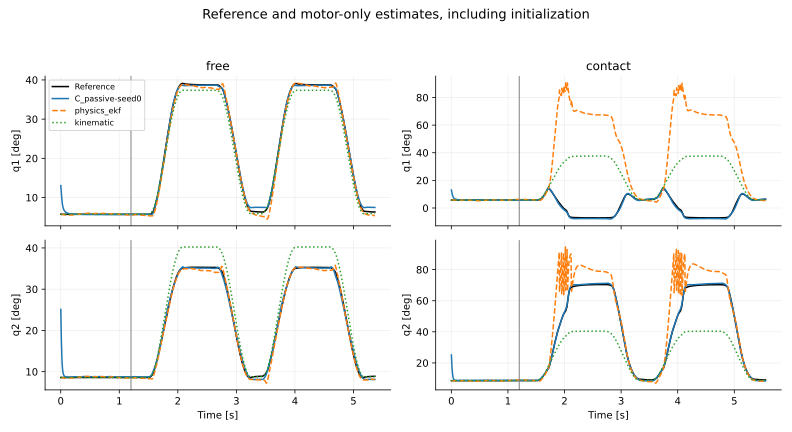
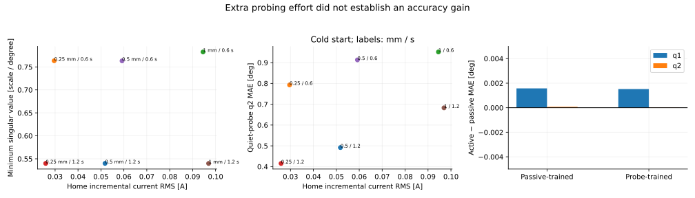

# Phase 3 — Calibrated Motor-Only Joint Proprioception

A fixed, referenced setup supports accurate two-joint prediction in this numerical finger. Across three training seeds, the calibrated passive GRU achieves **0.301° / 0.345° free-motion MAE** and **0.416° / 0.491° controlled-contact MAE** after the common 1.2 s initialization prefix. Small active probes did **not** establish an additional accuracy benefit. These results concern a specified synthetic mechanism and task distribution; they are neither hardware validation nor a proof of observability.

## Reference plant and calibration

The audit and pre-test criteria are recorded in [PHASE3_DESIGN.md](PHASE3_DESIGN.md). Phase 3 extends the existing Phase 2 simulator through an opt-in wrapper. The original transmission, motor, telemetry, finger, training scripts and published results remain unchanged. The report checks all 26 published Phase 2 source hashes, allowing Windows CRLF conversion when comparing text content. The original 66 tests pass within the expanded **88-test** suite. A frozen Phase 2 checkpoint was replayed on its original test data before the new study.

`Finger.reset(q0, pretension)` constructs a new spring preload and tendon zero. Reusing it for every perturbed state would repeat the Phase 2 unknown-setup comparison. Here, the wrapper establishes a reference, retains its spring preload and tendon zero, and then sets actual initial joints. A static two-port preparation establishes a consistent distal boundary while a hypothetical jig holds the finger. This preparation is outside the reported time and energy boundary. Motor feedforward uses nominal pretension, including when actual pretension differs.

The nominal home is `[0.1, 0.15] rad`, pretension is 10 N, each passive stiffness is 0.08 N m/rad, damping is 0.004 N m s/rad, and tendon offsets are 8 mm. Routing is the existing `large_guide` fixture. Cable mechanics reuse the dimensioned Phase 2 reference; parameter values and tolerances remain hypothetical.

| Condition | Known setup | Remaining uncertainty |
|---|---|---|
| A — Unknown setup | Motor encoder zero | Home offset: q1 −0.12…0.25 rad, q2 −0.08…0.50 rad; tendon zero ±0.8 mm; pretension 8…12 N |
| B — Homed | Home and tendon zero | Pretension 9…11 N; each passive stiffness ±5% |
| C — Calibrated | Home, motor/tendon zero, preload, pretension, nominal mechanics and fixed fixture | Simulated telemetry noise and finite actuator/emulator behavior |

This is **one-time reference calibration**, not motor-only calibration. On hardware, home requires an angle-referenced jig or independent joint encoders; zero requires boundary encoders; pretension requires input/output load cells; spring preload and fixture geometry require measured setup information. The simulation constructs those references using its model. No homing controller or repeatability study on physical hardware was executed. Figure 2 therefore shows the actual post-reference hold, not an invented homing trajectory.

At inference, every GRU reads only `[motor position, motor velocity, measured current, applied current command]`. It receives no joint angle, distal tension, deformation, contact label, routing identifier, calibration metadata or true parameter. The application selects a model for its known calibration regime; the network does not infer that regime from privileged metadata.

## Dataset and observer comparison

The initial 21-session pilot checked calibration, finite states and contact before expansion. The final dataset contains **146 complete sessions**: 64 training, 16 validation and 66 held-out sessions. All are eligible under the recorded physical gates. Two unknown-setup training/validation runs retain `prefix_contact_transition` flags; no calibrated C prefix changes contact state. Every configuration and flag is exported in the verification JSON.

Each of A, B, C-passive and C-probe has 16 training, 4 validation and 6 primary test runs. Primary tests contain three free and three contact runs per case. Tasks use 10–18 mm reel-in references, 1.8–2.4 s periods and two press/release cycles. Task draws are identical across calibration cases, independent of calibration draws. In A/B, active prefixes and contact are independently balanced. C-passive and C-probe differ only in the prefix action; their later command, duration, setup, task seed and noise streams match.

Seven additional groups contain six held-out runs each: changed preload, tendon zero, routing, passive stiffness, mechanical drift, contact conditions and a constant-mechanics long-run reference. Drift and its reference share six-cycle commands and initial conditions. Contact location and stiffness vary one at a time. Each run starts a separate specimen history; no window from that history crosses train/validation/test boundaries. Analysis trajectories are stored separately in `observability.h5`, and twelve telemetry-sensitivity runs in `sensor.h5` are excluded from training.

Five training cases use the same **32-unit GRU, 3,714 parameters, two joint outputs and seeds 0/1/2**. The pooled case has the same total run budget, allocated across calibration cases. Training uses 128-sample causal windows, a 32-sample loss burn-in, batch size 32, Adam at 0.003 and 60 epochs. Training-only statistics normalize inputs and targets. Validation post-prefix normalized MSE selects checkpoints; no test data enter selection. The selected epochs are:

| Case | Seed 0 | Seed 1 | Seed 2 |
|---|---:|---:|---:|
| A | 32 | 48 | 54 |
| B | 55 | 54 | 56 |
| C-passive | 60 | 60 | 59 |
| C-probe | 60 | 60 | 59 |
| Pooled | 9 | 9 | 7 |

Primary criteria were fixed before test inspection: below 2° MAE per joint in calibrated free motion and below 5° in controlled contact, assessed after the 1.2 s prefix. Full-run, initial 0.3 s, settling and contact-phase metrics remain separate mandatory outputs. Evaluation resets recurrent memory and runs continuously at 200 Hz. Joint outputs are not clipped. The original Phase 2 model has a different dataset and a third tension output; its frozen replay is a reference rather than an equal-budget ablation.

## Joint-estimation results

Numbers below are equal means over runs, followed by means across three training seeds. The uncertainty is sample SD across those seed means, not a confidence interval over physical experiments.

| Matched training / test case | Free q1 / q2 MAE [deg] | Contact q1 / q2 MAE [deg] |
|---|---|---|
| A — Unknown setup | 2.775 / 6.390 | 2.151 / 5.900 |
| B — Homed | 2.768 / 3.012 | 1.463 / 1.261 |
| C — Calibrated, passive | **0.301 ± 0.066 / 0.345 ± 0.046** | **0.416 ± 0.067 / 0.491 ± 0.095** |
| C — Calibrated, probing | 0.286 ± 0.058 / 0.347 ± 0.047 | 0.409 ± 0.065 / 0.488 ± 0.103 |

All three calibrated seeds meet the stated post-prefix engineering targets. These interventions bundle known home, zero, preload and mechanics; the table does not identify the causal contribution of each. The equal-budget pooled model gives 1.977° / 3.835° on calibrated passive free tests and 2.754° / 4.919° on calibrated passive contact tests. Its allocation across conditions differs from the dedicated calibrated model.

Initialization is a material limitation. The largest errors in the first 0.3 s across calibrated passive primary runs and seeds are **7.31° / 19.97°**. The network has a cold hidden state even though the physical home is known. The headline MAEs therefore do not describe immediate startup accuracy. Full per-run MAE, RMSE, 95th-percentile absolute error and maxima are retained for every model, window and test run. Aggregated percentiles and maxima are means of per-run values; `worst_full_error_deg` separately gives the maximum across runs.



### Do simple baselines suffice?

The kinematic baseline assumes rigid transmission and equal increments of both joints about known home. The reduced physics observer uses calibrated geometry, passive springs/damping, a fixed home inertia matrix and a scalar tendon-length update in a four-state EKF. Motor current/dynamics supply a nominal tension estimate. Its effective compliance, **0.19564 mm/N**, and offset, **0.03162 mm**, are fitted once using the same 16 C-passive training joint references; evaluation does not refit them. EKF length-noise and velocity-process scales are fixed at 0.3 mm and 0.03 rad/s. This observer omits contact forces and is a free-space baseline.

| Model, identical C-passive held-out episodes | Free q1 / q2 MAE [deg] | Contact q1 / q2 MAE [deg] |
|---|---|---|
| Rigid equal-increment kinematics | 1.059 / 2.970 | 22.918 / 14.941 |
| Reduced free-space physics EKF | **0.578 / 0.520** | 43.104 / 7.742 — outside model scope |
| Frozen Phase 2 GRU, seed 0 | 2.316 / 2.492 | 0.825 / 1.096 |
| Calibrated GRU, seed 0 | 0.370 / 0.328 | 0.474 / 0.449 |

The physics baseline already meets the 2° free-motion criterion. A neural history model is therefore **not necessary to meet that target** in this fixed regime. Its lower reported free error does not establish an advantage over a fully tuned physics model. The free-space EKF's contact failure diagnoses a missing contact model; it cannot establish that contact estimation requires a neural network.

### Contact and changed conditions

Offline scoring derives contact from a 30 ms causal force filter, 0.1/0.05 N hysteresis and a 50 ms dwell. Onset and release windows last 0.2 s; recovery covers 0.2–0.5 s after release. These labels never enter neural inference or the training loss. Raw solver contact flags remain available but are not treated as completed press cycles.

For calibrated passive seed 0, onset MAE is 0.785° / 0.176°, sustained contact 0.560° / 0.549°, release 0.360° / 0.237°, and recovery 0.283° / 0.624°. Three-seed per-run breakdowns remain in the JSON. Contact changes the mechanics and local sensitivity; this does not establish that arbitrary unknown contact improves observability.

The separate contact sweep uses a rigid box on the existing spring-supported slide. It is not a perfectly immovable rigid constraint. At x = 55 mm, support stiffness spans 500, 1,000, 8,000 and 50,000 N/m; at 1,000 N/m, x spans 45, 55 and 65 mm. Frozen C-passive seed-0 errors are 3.059° / 3.093° at 45 mm and 0.486° / 0.663° for the stiffest support. These are one scenario per setting, not a hardware generalization study.

The same frozen model degrades to 1.565° / 1.714° for preload offsets, 1.573° / 1.800° for ±0.5 mm tendon-zero errors and 1.014° / 1.151° for changed routing. Changing k2 by 50% **without recalibration** gives 27.119° / 28.911°. Drift gives 0.505° / 0.509°, compared with 0.442° / 0.407° in its matched six-cycle constant-mechanics reference. This accelerated short simulation does not establish performance over physical operating months or identify an evolving material parameter.

## Active probing and finite-horizon distinguishability

The executed library includes hold, monotonic flexion/extension, low-amplitude cycling, bidirectional pulse, oscillation, chirp, multisine and reversal. The standard bound is **0.5 mm over 1.2 s**. Multisine components are 1, 2 and 3 Hz under a smooth envelope. The bound is not the achieved peak: the nominal home multisine commands approximately 0.237 mm and achieves approximately 0.255 mm motor travel. Envelopes and nonlinear reversals are not strictly band-limited. Additional home multisines vary bounds from 0.25 to 1 mm and duration from 0.6 to 1.2 s.

At home, a frozen passive-trained model's mean active-minus-passive post-prefix error is **+0.001575° / +0.000070°**; the probe-trained model gives **+0.001521° / +0.000016°**. These average the same six physical task pairs for each of three seeds. Positive means active was worse. The small matched-training q1 difference between C-passive and C-probe also includes separate model selection and training distributions. **No additional probing benefit is established.**



Sensitivity tests hold material, routing, tendon zero, preload, sensor calibration and environment fixed. They perturb actual joints by ±0.002 rad and prepare mechanically consistent cable/boundary states before jig release. Home, flexed and contact operating points use the same procedure. This derivative concerns a **prepared released-state family**: cable state follows its stated preparation. It is not a derivative over every independently unknown internal state.

Columns are scaled per degree and motor channels by `[2π/16384 rad, 0.002 rad/s, sqrt(2)×0.005 A, 0.001 A]`. The command scale is a comparison scale. Diagnostics use quiet trajectories; the current scale is not a complete colored-noise covariance model. Raw and horizon-RMS singular values, condition numbers and column correlations are saved. They are not Fisher-information confidence bounds.

| Operating point | Hold minimum RMS singular value | Multisine minimum RMS singular value |
|---|---:|---:|
| Home | 0.5401 | 0.5400 |
| Flexed | 1.5464 | 0.7816 |
| Contact | 5.0823 | 5.3618 |

The multisine does not improve the weak home direction and worsens this metric at the flexed point. Its contact increase remains unresolved: the 0.115° finite-difference perturbation is comparable with contact joint timestep sensitivity. Home condition numbers remain approximately 21; nearly aligned sensitivity columns persist. Projecting the home joint derivatives away from linearized zero/preload nuisance directions reduces the minimum value from 0.5401 to 0.02285. This illustrates calibration dependence locally; the ratio is not a percentage of identifiable state or a calibrated uncertainty estimate.

Frozen observers were also evaluated on every quiet probe trial. Full and post-300 ms errors are exported. Flexed/contact trials start away from the training home, with cold recurrent state; these diagnostic scores are kept separate from the noisy paired task benchmark. Current effort relative to 2 A includes loaded-hold effort at flexed/contact points, so effort-versus-protocol comparisons in Figure 11 use home trials.

### Restricted identical-setup ambiguity search

Seven initial states lie on the same tendon-length contour around home, with q1 from 0.02 to 0.18 rad and q2 solved geometrically. They share exactly the same tendon zero, spring reference, material, fixed fixture, sensors and free-space environment. Their valid released trajectories are compared over 0.1, 0.25, 0.5 and 1.2 s.

No pair meets both criteria: motor-history RMS difference at most one comparison scale and joint-trajectory RMS gap at least 5°. The closest motor match among pairs exceeding the joint-gap criterion has a 5.423° gap and **10.071** normalized motor RMS over 0.1 s. This search does not reproduce Phase 2's across-setup ambiguity under known preload/zero. It also does not prove global observability: only seven states, one preparation family and four horizons were searched.

## Passive-mechanism study

Thirteen designs vary k1 or k2 from 0.08 to 0.04/0.16 N m/rad, damping to 0.002/0.008 N m s/rad, distal inertia tensor to 0.5×/2×, distal tendon offset to 6/10 mm and pretension to 6/14 N. Inertia changes retain mass and center of mass, avoiding a gravity confound. Pretension variants require new spring preload to retain the same home: this is an explicitly **coupled setup change**, not tension alone.

Each design records home sensitivity, free/contact motion, joint excursions, limits, motor effort, tension, contact behavior and calibration-nuisance sensitivity. One-factor stiffness/damping/routing-site changes use declared geometry and a recalibrated home reference. The nominal GRUs remain frozen, so their errors measure **transfer**. The physics baseline receives the declared static design and pretension, with the same nominal cable-compliance fit. It has a different design privilege; these scores are not an equal-information competition or design-specific NN optimization.

Increasing k2 to 0.16 raises the minimum home singular value from 0.540 to 1.640, but redistributes free joint range from approximately 34°/27° to 44°/15°. The frozen nominal seed-0 GRU then gives approximately 6.86°/8.41° error. Reduced k1 also increases sensitivity while approaching a joint limit for about 2.4% of its free trace. Trajectory second/first singular-value ratios remain small in several designs; a nearly one-dimensional motion distribution must not be confused with independent two-joint information.

Lower damping increases the tested sensitivity; changing inertia at fixed mass has little effect in these trials. Pretension changes strongly degrade frozen-network transfer. The sweep identifies tradeoffs rather than an optimal mechanism. It does not show that stiffness asymmetry always improves prediction or structural observability.

## Numerical and sensor limits

The outer-step sweep holds the plant/controller step at 25 µs and refines MuJoCo from 1 ms to 0.125 ms. Separate 50/100 µs plant/controller cases retain a 0.5 ms outer step. Outer-step errors decrease toward the refined trajectory, but combined plant/controller-rate changes are **not monotonic**. The nominal 0.5 ms / 100 µs case differs from the finest reference by 0.016°/0.013° free and 0.027°/0.111° contact joint RMSE; contact-force RMSE is 0.115 N. The unusually small nominal free error can reflect error cancellation, not a converged truth. Every rate, joint/force error and transmission energy residual is exported.

These differences preclude interpreting thousandths-of-a-degree probing differences as physical benefits. The transmission ledger checks its own force–motion boundary; it is not a whole-system electrical energy balance. Existing and new tests cover current/torque consistency, geometry/Jacobians, calibration repeatability, causality, train-only fitting and exclusion of privileged inputs. Simulated effort limits are not hardware safety specifications.

The twelve frozen-observer telemetry trials vary white-current σ = 0/0.005/0.02 A or delay = 0/1/5 ms. They retain colored current noise σ = 0.005 A and a 2 ms frontend filter. Physical joint trajectories are exactly identical within each environment/factor sweep. Increasing delay to 5 ms raises mean free q1 error from about 0.40° at 1 ms to 0.48°, and contact q2 from 0.72° to 0.82°. White-noise changes are small in this filtered test. There is one underlying physical trajectory per environment and three trained observers, not independent noise realizations for statistical robustness. The plant controller still reads true rotor state; this tests observer telemetry sensitivity, not noisy feedback control.

## Optional reachable-posture control

All three controllers share targets generated from a one-time numerical joint-reference calibration at motor offsets 2, 5, 8 and 4 mm. The bank uses 3 s holds, averaging the final 0.3 s; the observer warms for 1.2 s. The single actuator cannot command arbitrary independent joint targets. Neural feedback receives only four motor channels, while the oracle receives true joints. Both feedback variants share a bounded correction and the same feedforward map, target order and physical seed 9001.

| Controller | Full q1 / q2 tracking MAE [deg] | Settled q1 / q2 MAE [deg] |
|---|---|---|
| Calibrated open-loop feedforward | 0.684 / 0.486 | **0.268 / 0.206** |
| Motor-only neural feedback | 0.752 / 0.539 | 0.432 / 0.325 |
| True-joint oracle feedback | **0.567 / 0.397** | 0.206 / 0.158 |

The neural controller follows reachable postures but **does not outperform calibrated feedforward**. Step-transition peak errors reach approximately 12°/10° even with oracle feedback. This is a finite-time step response, not evidence that the chosen targets are unreachable. No contact-control or hardware result is claimed.

## Figures and saved evidence

The [verification JSON](../../public/assets/data/tendon-in-the-loop/phase3-verification.json) contains configurations, dataset/source/checkpoint hashes, all three learning histories, selected checkpoints, runtime measurements, all per-run errors and diagnostic results. Fifteen SVGs are exported under `public/assets/img/tendon-in-the-loop/phase3/`:

1. Recorded calibrated configuration and actual MuJoCo tendon site geometry.
2. Post-reference hold and measured pretension.
3. Executed motor probe commands and achieved travel.
4. Joint references and predictions, including initialization.
5. Contact-phase errors.
6. Four-channel conditional joint sensitivities.
7. Singular values, conditioning and correlation across protocols/operating points.
8. Fixed-setup ambiguity search and selected trajectories.
9. Calibration regimes and changed-condition transfer.
10. Mechanism sensitivity, joint range, trajectory rank and estimation tradeoffs.
11. Probe effort, duration, diagnostic error and paired task accuracy.
12. Reachable-posture control.
13. Outer-step and plant/controller-rate sensitivity.
14. Telemetry noise/delay sensitivity.
15. Known-setup versus calibration-nuisance sensitivity.

Inference is benchmarked for 500 single-frame CPU calls with the first 100 discarded, using two PyTorch threads. C-passive seed 0 measured approximately 98 µs median / 156 µs p95 in the recorded run; weights occupy 14,856 bytes. Runtime is machine-specific. Training used Python 3.13.5, NumPy 2.5.5 and PyTorch 2.15.0+cpu; other installed package versions are recorded in the JSON.

Raw HDF5, prediction arrays, logs and checkpoints remain under ignored local `data/phase3/` and `figures/phase3/`; public reports/figures and all generators are versioned. Training ran on `controlled.h5` (140 sessions). Adding six held-out long-reference runs created `phase3.h5` (146); all train/validation episodes and weights stayed unchanged. Both hashes are retained. A separate frozen-checkpoint evaluation of all 66 final held-out runs reproduced C-passive seed-0 metrics exactly without recalibration or training.

## Reproduction

Run from `sim/tendon-in-the-loop` with its existing environment and `requirements-observer.txt` installed. The commands below generate the final design directly, rather than requiring intermediate development files. Use fresh output paths when regenerating datasets. Generation, fitting, frozen evaluation and export remain separate.

```powershell
.venv/Scripts/python.exe -m pytest -q
.venv/Scripts/python.exe scripts/phase3_dataset.py --scale pilot --all --workers 4 --out data/phase3/reproduce-pilot.h5
.venv/Scripts/python.exe scripts/phase3_dataset.py --scale full --all --workers 4 --out data/phase3/phase3.h5
# Inspect the exported manifest and diagnostic flags before training.
.venv/Scripts/python.exe scripts/phase3_calibrate.py --dataset data/phase3/phase3.h5 --out figures/phase3/physics-calibration.json
.venv/Scripts/python.exe scripts/phase3_experiments.py --dataset data/phase3/phase3.h5 --out figures/phase3/full --epochs 60 --workers 2
.venv/Scripts/python.exe scripts/phase3_evaluate.py --dataset data/phase3/phase3.h5 --experiments figures/phase3/full --calibration figures/phase3/physics-calibration.json --out figures/phase3/evaluation
.venv/Scripts/python.exe scripts/phase3_study.py --out figures/phase3/study --workers 4
.venv/Scripts/python.exe scripts/phase3_study.py --out figures/phase3/study --mechanisms --workers 4
.venv/Scripts/python.exe scripts/phase3_probe_evaluate.py --study figures/phase3/study --models figures/phase3/full --calibration figures/phase3/physics-calibration.json --out figures/phase3/study/probe-evaluation.json
.venv/Scripts/python.exe scripts/phase3_mechanism_evaluate.py --study figures/phase3/study --models figures/phase3/full --calibration figures/phase3/physics-calibration.json --out figures/phase3/mechanism-evaluation
.venv/Scripts/python.exe scripts/phase3_calibration_sensitivity.py --out figures/phase3/study/calibration-sensitivity.json --workers 4
.venv/Scripts/python.exe scripts/phase3_export_analysis.py --study figures/phase3/study --out data/phase3/observability.h5
.venv/Scripts/python.exe scripts/phase3_verify.py --out figures/phase3/verification --workers 4
.venv/Scripts/python.exe scripts/phase3_sensor_sweep.py --out data/phase3/sensor.h5
.venv/Scripts/python.exe scripts/phase3_evaluate.py --dataset data/phase3/sensor.h5 --experiments figures/phase3/full --calibration figures/phase3/physics-calibration.json --out figures/phase3/sensor-evaluation --skip-baselines --only C_passive-seed0 C_passive-seed1 C_passive-seed2
.venv/Scripts/python.exe scripts/phase3_control.py --checkpoint figures/phase3/full/C_passive-seed0/checkpoint.pt --out figures/phase3/control
# Deterministic frozen-checkpoint replay: no fitting command is invoked.
.venv/Scripts/python.exe scripts/phase3_evaluate.py --dataset data/phase3/phase3.h5 --experiments figures/phase3/full --calibration figures/phase3/physics-calibration.json --out figures/phase3/replay --skip-baselines --only C_passive-seed0
.venv/Scripts/python.exe scripts/phase3_report.py
```

The calibrated positive result depends on known setup, fixed mechanics and represented tasks. Small probing did not improve it; changed passive mechanics can destroy it; simple calibrated physics already meets the free-space target. Independent joint and tension references on the proposed HIL hardware are still required to test transfer beyond this numerical plant.
