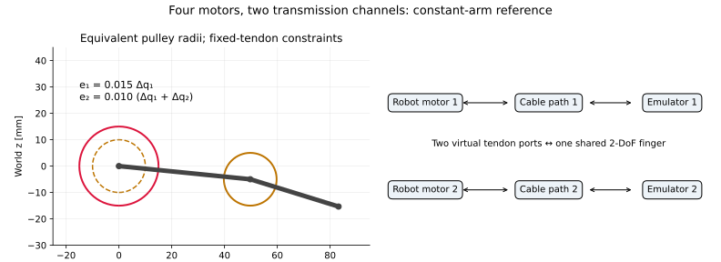
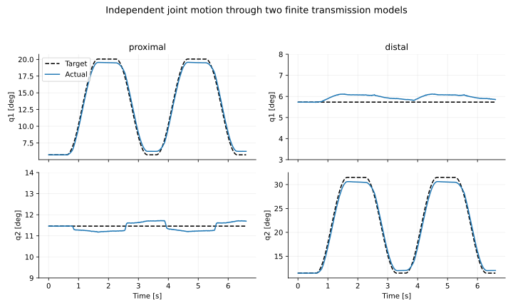
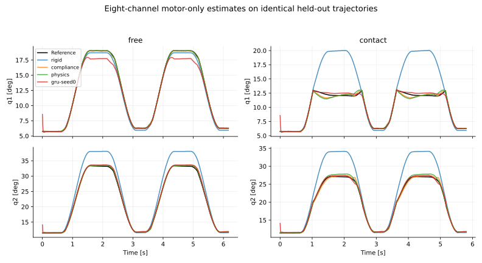

# Two-Tendon Architecture Correction and Numerical Verification

The new reference contains **two robot actuator motors, two finite-force emulators, two separate transmission states and one shared 2-DoF MuJoCo finger**. Tendon 2 acts on both joints. Free-space motor-displacement control independently moves either joint while approximately holding the other. A calibrated deformation correction reconstructs the joints more accurately than the small GRU on the nominal held-out runs. These are numerical results for an explicitly approximated pulley mechanism; physical routing and HIL hardware remain unvalidated.

## Architecture audit and routing assumptions

The original Python implementation has one spatial flexor tendon, one QDD actuator and one emulator driving two joints. Its Phase 1–3 results remain reproducible **single-tendon, underactuated** studies. The new `TwoTendonFinger` and `TwoTendonSimulator` are separate classes. No previous model, checkpoint, dataset, report or figure was replaced. All 88 pre-existing tests passed before this work; the expanded suite passes **97 tests**.

The website's `TendonInTheLoop2DoFDemo.tsx` expresses the intended four-motor architecture, but integrates independent joint PD equations and imposes excursions rather than deriving them from its drawing. Its proximal idler arcs vary by +q1 and −q1 and therefore cancel in total centerline length. The inter-pulley spans and distal half-wrap retain their lengths; q2 does not change those SVG path coordinates. The visualized centerline alone consequently cannot establish the proposed winding relation. Pulley material transport, no-slip winding, attachments, changing wrap and moving-rig work require a separate hardware routing derivation.

This implementation uses the permitted **constant-moment-arm equivalent winding reference**, represented by two MuJoCo fixed tendons. It does not claim to have reconstructed an exact spatial cable route. Body masses, capsule inertias, gravity, passive springs/damping, joint limits and sprung-box contact reuse the original finger model. The drawing below shows the equivalent radii and channel topology, not a solved cable centerline.



## Tendon coordinates and torque authority

Positive q denotes flexion, positive actuator x denotes reel-in, and positive distal x denotes lengthening away from the input side. Relative to calibrated home q0 = [0.10, 0.20] rad,

```text
e = A (q − q0)                 A = [[0.015, 0],
l = l_home − e                     [0.010, 0.010]] m/rad
x_out,command = −e             J_l = −A
tau_tendon = −J_l.T T_out = A.T T_out
q = q0 + inverse(A) e
```

The two MuJoCo fixed-tendon coordinates carry coefficients −A. Additive reference lengths of 0.15/0.20 m make the exposed lengths positive without changing virtual work or forces. There are no ideal joint actuator motors and no second application of tendon torque. MuJoCo generalized actuator forces are compared directly against the independently calculated Jacobian-transpose result.

The determinant is 0.00015 m²/rad². A 143-configuration grid covers q1 = −30…60° and q2 = 0…150°. Central differences with 1e−6 rad perturbations agree with the analytic and MuJoCo Jacobians within the declared 1e−8 m/rad tolerance. Zero, pretension, single-channel and 40 N corner loads agree with the torque mapping within 1e−8 N m. The JSON retains every grid result. Tendon 1 is independent of q2; tendon 2 has both nonzero joint coefficients by construction.

Tensions cannot push. The nominal 0–40 N operating envelope maps through A.T to a torque parallelogram. About the calibrated 10/10 N home, its net-torque corners are [−0.25,−0.10], [0.35,−0.10], [0.75,0.30] and [0.15,0.30] N m. Passive return springs and gravity supply the opposing torques. Static inverse dynamics find 517 of 625 sampled joint configurations feasible in free space under that envelope. This is not a dynamic reachability or contact-feasibility certificate.

Each QDD has a 20 mm drum, 0.1 N m/A nominal torque constant, 8 A current limit and a 1 ms current loop. The 40 N bound is its nominal steady force; inertial transients can differ. Explicit motor stops limit stroke to ±60 mm and speed to 1 m/s. Each emulator has finite 0.5 kg effective mass, an 80 N force limit, existing acceleration/velocity limits and ±50 mm stroke. The virtual 80 N tendon control bound is a protective numerical cap, distinct from the nominal operating envelope. None establishes hardware safety.

## Two-channel force–motion exchange

Each channel instantiates the unchanged scalar `TiLSimulator`, Phase 2 `TransmissionPlant`, QDD dynamics and causal telemetry frontend. A scalar boundary adapter reads one row of the shared finger's tendon geometry and suppresses the private scalar-chain finger step. Both channels read the same pre-step joint state. Each advances its own actuator, emulator, transmission and force measurement; the shared finger then receives both tensions and integrates **once**. Tests verify independent states, repeatability and shared integration time.

The emulator uses a force-limited dynamic actuator driven by a boundary-position servo. This reconciles finite motor force with displacement rendering; it is not validation of a pure force-controlled physical HIL interface. The cable sees the emulator's actual position and velocity, never a perfectly imposed future finger position. Input/output load cells, two motor observation groups, two emulator groups, two transmission groups, true internal states and the shared virtual state remain separate in HDF5.

The eight inference channels are exactly:

```text
motor1/position, velocity, current, applied_command
motor2/position, velocity, current, applied_command
```

Distal force, emulator motion, joint states, deformation, contact, routing IDs and true parameters are excluded. The inherited actuator's inner position loop reads true rotor state; modeled encoder noise/delay affects the observer telemetry. Thus this study does not establish robustness of a noisy physical inner servo. Input and output forces and apparent deformation are saved for both channels. Phase 2 friction-state units are explicitly normalized to radians rather than the legacy single-tendon torque-state label.

## Independent joint positioning

Before collecting training data, four motion families were executed with rigid and elastic-compensated motor feedforward, in free space and with an object: **16 trials**. The nominal reference starts with a 0.6 s hold, then two 3 s cycles. Single-joint amplitudes are 0.25 rad proximal and 0.35 rad distal. Reversal uses bounded positive and negative excursions. No true joint state enters the controller: it uses desired joints, inverse tendon geometry, nominal passive/gravity statics and nominal cable compliance. Two motor position loops generate current commands and interact with the actual two-port plants.

| Free-space motion | Rigid feedforward q1 / q2 MAE [deg] | Elastic feedforward q1 / q2 MAE [deg] |
|---|---|---|
| Proximal only | 0.874 / 0.392 | **0.501 / 0.202** |
| Distal only | 0.539 / 2.371 | **0.253 / 0.772** |
| Coordinated | 0.435 / 1.793 | **0.457 / 0.350** |
| Flexion/extension reversal | 0.448 / 0.629 | **0.445 / 0.295** |

Tracking scores cover t ≥ 0.6 s, including holds and release. Per-joint RMSE and peak error are also retained. All elastic free-space trajectories meet the predeclared <2° joint MAE target; the held joint remains below 1°. They have no current/force/stroke limit events or slack and remain within the static free-space tension envelope. This demonstrates independent motion in the chosen feasible region, not arbitrary signed joint torque authority.



The proximal contact trial reaches 0.919 N peak normal force and 1.508°/0.406° MAE. Coordinated contact reaches 2.814 N and 3.927°/1.691° MAE, with peak input/output tensions below 22 N. Its target uses free-space inverse dynamics; contact adds an unmodeled load, so the target is not imposed and exact contact feasibility is not certified. The selected distal-only and reversal trajectories never touch this object. They are retained as no-contact outcomes, not counted as successful contact-control tests. Contact simulation uses a rigid box on a spring-supported slide, not an immovable rigid wall.

## Mechanical, numerical and energy verification

All pre-learning gates in [TWO_TENDON_DESIGN.md](TWO_TENDON_DESIGN.md) pass: Jacobian, torque, isolated energy, free-space positioning, held-joint accuracy, nominal timestep convergence and six-session pilot validity. The gates apply to the stated equivalent mechanism; they do not certify the unresolved physical route.

The outer-step sweep uses 1/0.5/0.25/0.125 ms MuJoCo steps with a fixed 25 µs transmission step and 100 µs motor-controller period. Separate tests vary transmission step, controller period, emulator delay and contact solver time constant. Against the 0.125 ms / 25 µs reference, the nominal 0.5 ms / 100 µs case gives:

| Condition | Joint RMSE q1 / q2 [deg] | Distal tension RMSE channel 1 / 2 [N] |
|---|---|---|
| Free | 0.00513 / 0.00670 | 0.000192 / 0.000183 |
| Contact | 0.00386 / 0.00592 | 0.001650 / 0.001743 |

These meet the declared 0.25° free, 0.5° contact and 1 N tension tolerances. Every perturbed result, contact-force discrepancy, tracking error and validity flag remains in the JSON. This is convergence evidence for specified trajectories, not an exact continuous-time ground truth or a reason to interpret arbitrarily small observer differences as physical gains.

Separate boundary-driven cable tests use 100/50 µs steps, linear elasticity, friction, damping and no aging/Maxwell branch. Each channel satisfies its own input/output work ledger; peak residual decreases from 1.29e−8 to 7.06e−9 J with refinement. Tests also exercise slack, motor stroke and emulator force saturation. The controlled system retains separate virtual-port work and physical output-port work: final mismatch in the coordinated free/contact trials is approximately +10/+43 µJ and −27/−24 µJ for channels 1/2. Those residuals do not establish passivity or complete electrical/mechanical energy balance of a physical four-motor rig.

## Motor-only inference and strong baselines

The final **72 sessions** comprise 16 training, 8 validation and 48 held-out runs. Every run completed without the recorded tension, tracking or actuator-limit diagnostic flags. Episode specifications, per-channel mechanics, calibration assumptions, seeds and sensor settings are exported. Raw data/checkpoints remain under ignored `data/two-tendon/` and `figures/two-tendon/` directories; generators, reports and figures are versioned.

The eight nominal test runs contain six trajectories with no sustained contact and two with contact. Labels use the existing 30 ms force filter, 0.1/0.05 N hysteresis and 50 ms dwell, for scoring only. Training has four actual-contact sessions and validation has two. A requested object placement does not guarantee contact. The nominal table therefore groups by **actual observed contact**, and reports full-run errors including startup.

Four methods receive the same motor histories and calibration assumptions:

- **Rigid kinematics:** e = 0.02 [motor angle 1, motor angle 2], followed by inverse(A).
- **Compliance correction:** subtract an identified incremental deformation before inversion. Train-only joint references fit per-channel compliance of 0.2072/0.2043 mm/N and offsets −0.00971/−0.00185 mm. Current, rotor dynamics and a nominal presliding proxy estimate tendon loading; no distal load cell is used at inference.
- **Reduced physics filter:** calibrated passive/gravity dynamics, home inertia matrix and a two-length EKF update. Its process and measurement covariance are estimated from residuals on the same 16 training references. Offline differentiation of training joint labels is used only in this fit. Contact dynamics remain omitted.
- **GRU:** eight inputs, 32 hidden units, two joint outputs and **4,098 parameters**. Seeds 0/1/2 use identical 60-epoch budgets, 128-sample causal windows, 32-sample loss burn-in, batch size 32, Adam at 0.003 and training-only normalization. Full-run validation MSE selects epochs 59/60/60. No test group enters training or checkpoint selection. Outputs are not clipped.

| Nominal held-out group | Rigid q1 / q2 MAE [deg] | Corrected q1 / q2 | Physics q1 / q2 | GRU, three-seed mean q1 / q2 |
|---|---|---|---|---|
| Free, 6 runs | 0.526 / 1.519 | **0.089 / 0.153** | **0.074 / 0.145** | 0.150 / 0.207 |
| Contact, 2 runs | 2.084 / 1.758 | **0.134 / 0.137** | 0.160 / 0.165 | 0.162 / 0.253 |

The simple calibrated correction outperforms the GRU's mean in both nominal groups. The physics filter gives slightly lower free error but slightly higher contact error. There is **no demonstrated need for neural learning** to obtain accurate reconstruction in this fixed calibrated reference. Three-seed GRU SD is 0.013°/0.053° free and 0.041°/0.057° contact; these are training-seed variations, not hardware confidence intervals. GRU full-run peak errors reach 2.83°/3.02°. Initialization, steady holds, velocity reversal, contact onset, sustained contact, release, MAE/RMSE/p95/max and the worst across runs are retained separately.

The physics baseline was developed iteratively. Its first fixed-noise version assumed 150 µm length noise and 0.03 rad/s process noise; it over-trusted a free-space dynamics approximation, especially during contact. Its errors remain saved as a diagnostic reference. Training residuals instead give 31.8/35.0 µm length scales and much larger model-discrepancy scales. The revised filter consequently relies strongly on the two independent length updates; good filtering does not validate its contact dynamics. Test runs had already been inspected during that diagnosis, so this is not a preregistered blind comparison, although fitted covariances and model weights use training references only. Neither engineering acceptance tolerances nor the historical Phase 1–3 results were changed.



## Changed mechanics and recalibration

Ten additional held-out groups contain four runs each, with separate seeds from training/validation. They vary an elastic reference without guide friction or Maxwell memory, friction without Maxwell memory, a finite 20× stiffer cable, channel-2 stiffness, channel-2 routing, pretension, encoder reference zero, slow mechanical evolution, contact conditions and a matched long constant-mechanics reference. The elastic reference retains axial damping and nonlinear stiffness. Drift/reference runs share commands, initial setup and seeds over six cycles. Each entire specimen history stays within one split; windows never cross run/split boundaries.

| Held-out change | Compliance q1 / q2 MAE [deg] | Physics q1 / q2 | GRU three-seed q1 / q2 |
|---|---|---|---|
| Channel-2 modulus ×0.65 | 0.083 / 1.180 | 0.106 / 1.055 | 0.122 / 0.673 |
| Channel-2 two-guide fixture | 0.084 / 0.524 | 0.265 / 0.361 | 0.502 / 1.142 |
| Pretension 12/8 N | 1.621 / 4.066 | 0.480 / 1.501 | 0.999 / 3.924 |
| Reference zero +0.5/−0.5 mm | 1.907 / 4.726 | 1.625 / 4.031 | 1.045 / 2.223 |
| Accelerated evolution, 6 cycles | 0.111 / 0.212 | 0.132 / 0.204 | 0.110 / 0.208 |
| Constant mechanics, matched 6 cycles | 0.094 / 0.169 | 0.109 / 0.156 | 0.109 / 0.176 |
| Changed contact location/stiffness | 0.125 / 0.183 | 0.162 / 0.247 | 0.386 / 0.725 |

Pretension changes also reset passive spring preload to retain home; this is a coupled setup change. The zero test changes the observed encoder reference, not the physical cable constitutive law. Contact cases vary x = 45/65 mm at 1,000 N/m and support stiffness = 500/8,000 N/m at x = 55 mm. Material values, calibration tolerances and aging rates are hypothetical.

A separate **known-home re-reference** uses the first acquired encoder frame to establish both motor zeros. It uses no true test joint/force label and no online learning, but assumes the reference home has been established by a jig. This restores the zero-test compliance error to **0.087°/0.163°**. It is an additional setup privilege, and does not show that arbitrary stiffness, routing or wear can be corrected by rehoming. Online adaptation was not introduced.

The GRU helps relative to the unchanged compliance fit under the selected stiffness and zero changes, but does not dominate across conditions. With the 20× stiffer cable, rigid reconstruction improves to 0.314°/0.370° while the nominal compliance correction overcompensates. The stiff cable is a finite dynamic proxy, not an exact inextensible simulation. The exact zero-deformation algebra is tested separately on 400 configurations and reconstructs to 4.44e−16 rad maximum error.

## Calibration and distinguishability

With known deformation, the full-rank A permits local reconstruction. Motor reel-in is instead e_motor = A(q−q0) + delta; unknown deformation or zero gives joint uncertainty inverse(A) delta. Full rank does not remove that uncertainty. The previous one-tendon ambiguity example is not transferred to this architecture or used as an equal-information neural benchmark.

Conditional finite-horizon tests perturb actual q1/q2 independently by ±0.002 rad, retaining identical tendon zeros, spring reference, material, fixture and sensor settings. Each cable boundary/state is prepared consistently before jig release. Quiet motor histories are scaled by [encoder step, 0.002 rad/s, sqrt(2)×0.005 A, 0.001 A] per motor. These comparison scales are not a full correlated sensor covariance.

Over 1.2 s, minimum RMS singular values are 5.192, 5.330 and 5.293 scale/degree for hold, coordinated perturbation and oscillation; condition numbers are approximately 4.9–5.0. These modest differences concern this prepared-state family, not a global observability proof or a demonstrated improvement in learned accuracy. A separate nine-state fixed-setup search at q0 ±0.04 rad finds no pair with motor-history RMS ≤1 scale and joint-trajectory RMS gap ≥3° over 0.005/0.01/0.025/0.05/0.1/0.25/0.6 s. The short horizons were added when rescoring saved traces because rapid relaxation removed the required angular separation at longer horizons. Only one comparison retains a ≥3° trajectory gap: 3.381° over 5 ms, with motor-history difference 373.2 scales. The absence of an ambiguous pair is therefore a particularly restricted result, not a broad search certificate.

Kinematic invertibility, conditional dynamic sensitivity and empirical estimation accuracy therefore remain distinct. Independent physical measurements are still required to validate cable mechanics and the actual P1/P2/idler routing.

## Artifacts, limitations and reproduction

The [machine-readable report](../../public/assets/data/tendon-in-the-loop/two-tendon-verification.json) retains all 72 configurations, resolved channel settings, three learning histories, selected checkpoints, per-run diagnostics, both physics-filter variants, rehoming comparison, geometry/torque grids, numerical/energy tests and thirteen SVG figures. Prefix replay reproduces joints and all eight noisy motor channels exactly for every mechanical condition. Separate frozen-checkpoint evaluation reproduces all final observer metrics exactly, with no fitting step.

Inference uses 200 Hz observations. Single-frame CPU median and p95 timing are recorded after 100 warmup calls out of 500 using two PyTorch threads. Runtime is machine-specific. Python, MuJoCo, PyTorch, NumPy, HDF5 and plotting versions plus source/dataset/checkpoint hashes are retained. No hardware measurements, literal spatial-routing validation, arbitrary torque authority, global observability or online adaptation is claimed.

Run from `sim/tendon-in-the-loop` in the existing environment with `requirements-observer.txt`. Use fresh dataset paths when regenerating. The optional fixed-noise diagnostic is included because report export retains that reference; the calibrated physics fit is the final comparison.

```powershell
.venv/Scripts/python.exe -m pytest -q
.venv/Scripts/python.exe scripts/two_tendon_control.py --out figures/two-tendon/control --workers 4
.venv/Scripts/python.exe scripts/two_tendon_verify.py --out figures/two-tendon/physics --workers 4
.venv/Scripts/python.exe scripts/two_tendon_dataset.py --scale pilot --out data/two-tendon/pilot.h5 --workers 3
.venv/Scripts/python.exe scripts/two_tendon_gates.py
.venv/Scripts/python.exe scripts/two_tendon_dataset.py --scale full --out data/two-tendon/full.h5 --workers 4
.venv/Scripts/python.exe scripts/two_tendon_units.py data/two-tendon/full.h5 data/two-tendon/pilot.h5
.venv/Scripts/python.exe scripts/two_tendon_observability.py --out figures/two-tendon/observability --workers 3
.venv/Scripts/python.exe scripts/two_tendon_evaluate.py --dataset data/two-tendon/full.h5 --calibrate --out figures/two-tendon/calibrated-physics.json
foreach ($seed in 0..2) {
  .venv/Scripts/python.exe scripts/two_tendon_train.py --dataset data/two-tendon/full.h5 --out "figures/two-tendon/models/seed$seed" --seed $seed --epochs 60
}
.venv/Scripts/python.exe scripts/two_tendon_evaluate.py --dataset data/two-tendon/full.h5 --calibration figures/two-tendon/calibrated-physics.json --models figures/two-tendon/models --out figures/two-tendon/calibrated-evaluation
.venv/Scripts/python.exe scripts/two_tendon_evaluate.py --dataset data/two-tendon/full.h5 --calibration figures/two-tendon/calibrated-physics.json --models figures/two-tendon/models --out figures/two-tendon/calibrated-replay
.venv/Scripts/python.exe scripts/two_tendon_rehome.py --dataset data/two-tendon/full.h5 --calibration figures/two-tendon/calibrated-physics.json --out figures/two-tendon/rehome.json
.venv/Scripts/python.exe scripts/two_tendon_replay_plant.py --dataset data/two-tendon/full.h5 --out figures/two-tendon/factory-replay.json
# Reproduce the initial fixed-noise physics diagnostic; GRU weights remain frozen.
.venv/Scripts/python.exe scripts/two_tendon_evaluate.py --dataset data/two-tendon/full.h5 --calibrate --fixed-physics-noise --out figures/two-tendon/compliance-calibration.json
.venv/Scripts/python.exe scripts/two_tendon_evaluate.py --dataset data/two-tendon/full.h5 --calibration figures/two-tendon/compliance-calibration.json --models figures/two-tendon/models --out figures/two-tendon/evaluation
.venv/Scripts/python.exe scripts/two_tendon_report.py
```

The numerical correction establishes an independently controllable two-input reference and shows why calibrated deformation modeling matters. It also shows that a small neural observer is not automatically the best estimator when two independent tendon excursions and a repeatable setup are available.
